# Contextual Bicycle Pacejka

This project trains neural-network policies to drive full laps of real circuits (Monza, Spa, Catalunya and Budapest) in a simulated race car. The car has domain-randomised vehicle parameters and tyre-road friction.

The final method is **behaviour cloning**: it learns from a scripted, model-aware teacher (MATv0) driving through a safety filter, with perturbed demonstrations. The resulting policies complete the laps without the safety filter at the teacher's pace. A policy trained on all four circuits is robust on all of them. A policy that never saw a circuit transfers to it once the racing line has no curvature kinks.

- Results: [docs/RESULTS.md](docs/RESULTS.md)
- How the method was reached, and what was abandoned: [docs/HISTORY.md](docs/HISTORY.md)
- Redesign in progress, from a privileged teacher to students that see only onboard sensors, trained offline: [docs/REDESIGN.md](docs/REDESIGN.md)

## Contents

- [Quick start](#quick-start)
- [The project at a glance](#the-project-at-a-glance)
- [Repository layout](#repository-layout)
- [1. Vehicle plant](#1-vehicle-plant--model)
- [2. Tracks and racing lines](#2-tracks-and-racing-lines--modeltrackpy-tracks)
- [3. Environment](#3-environment--env)
- [4. The learning problem: state, observation, action, reward](#4-the-learning-problem-state-observation-action-reward)
- [5. Teacher: MATv0](#5-teacher-matv0--controlteacherpy)
- [6. Safety filter](#6-safety-filter--controlsafety_filterpy)
- [7. The policy](#7-the-policy--learningpolicypy)
- [8. Training](#8-training--learning)
- [9. Evaluation](#9-evaluation--evaluation)
- [Models](#models)
- [Reproducing the pipeline](#reproducing-the-pipeline)
- [Figures of this README](#figures-of-this-readme)
- [Tests](#tests)

## Quick start

```bash
python -m venv .venv && source .venv/bin/activate
pip install -e ".[dev,figures]"

python examples/demo.py                # every circuit, zero-shot transfer, safety filter, friction, racing lines (~3 min)
python examples/demo.py --max-steps 2000             # the same, each episode stopped after 20 s
python examples/demo.py --circuit spa --policy loco_spa --condition F --mu 0.8 --seed 43
pytest -m "not slow"                   # fast regression tests (~1 min); `pytest` runs everything (~3 min)
```

The demo runs frozen evaluation-protocol episodes with the evaluation code itself. It prints one row per episode with:

- the outcome;
- the lap time;
- the safety-filter projections;
- the tracking errors with respect to the teacher;
- the 99th percentile of the rear slip ratio.

## The project at a glance

The pipeline has four stages. Tracks are prepared once. The teacher, driving through the safety filter, generates perturbed demonstrations. A policy is fitted to them by supervised regression. Every controller is then scored on frozen evaluation protocols. Weighted DAgger and PPO fine-tuning are kept in the code base but are paused: no final policy depends on them.

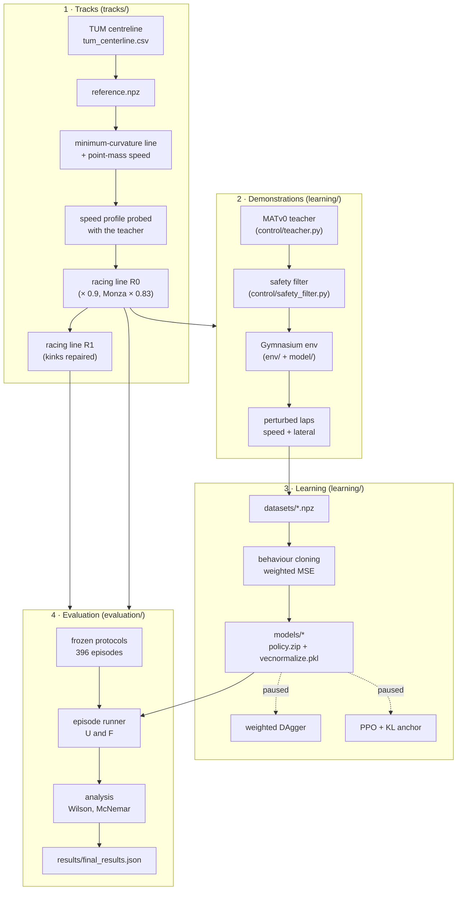

| Stage             | What it does                                       | Code                                   | Script                      | Output                          |
| ----------------- | -------------------------------------------------- | -------------------------------------- | --------------------------- | ------------------------------- |
| Tracks            | centreline → racing line → speed profile → R0 → R1 | `tracks/`                              | `scripts/prepare_tracks.py` | `data/tracks/<circuit>/`        |
| Demonstrations    | teacher laps with perturbed execution              | `learning/demonstrations.py`           | `scripts/generate_demos.py` | `outputs/demos/`                |
| Datasets          | concatenation of the kept laps                     | `learning/datasets.py`                 | `scripts/build_dataset.py`  | `datasets/*.npz`                |
| Behaviour cloning | actor regression + shielded gate                   | `learning/behaviour_cloning.py`        | `scripts/train_bc.py`       | `models/<name>/`                |
| Evaluation        | 396 frozen episodes per circuit and line           | `evaluation/protocol.py`, `episode.py` | `scripts/evaluate.py`       | `outputs/evaluation/*.jsonl`    |
| Analysis          | rates, intervals, paired tests, failure causes     | `evaluation/analysis.py`               | `scripts/analyze.py`        | `outputs/analysis/`, `results/` |

## Repository layout

```
src/contextual_bicycle_pacejka/   the Python package
  spec/         constants, vector layouts (state, setup, 116-entry observation, action), setup normalisation
  model/        vehicle plant (actuator, tyres, load transfer, powertrain, dynamics), track, observation,
                sensors, student observation, termination, reward and traction cost; no Gymnasium dependency
  env/          Gymnasium environment, factory, setup sampling (domain randomisation), student observation wrapper
  tracks/       racing-line preparation: TUM centreline -> minimum-curvature line -> probed speed profile
                -> racing line R0 -> kink repair R1
  control/      MATv0 teacher and the safety filter
  learning/     policy I/O, perturbed demonstrations, datasets, behaviour cloning, friction estimator and its
                closed-loop data, offline RL (IQL, TD3+BC), the coach (online RL without the teacher's plan), the
                plan coach (online RL of the speed plan a student drives), column statistics of large datasets,
                weighted DAgger (paused), PPO fine-tuning (paused)
  evaluation/   frozen protocols, episode runner, failure diagnostics, analysis (Wilson, McNemar, ...), measures of
                independence from the teacher
scripts/        one command-line entry point per pipeline stage (see below)
examples/       demo.py
tests/          regression tests; tests/golden/ holds recorded reference outputs
data/
  tracks/<circuit>/   TUM centreline, reference, racing lines R0 / R1 and their intermediates
  protocols/          frozen evaluation protocols, 396 episodes per circuit and racing line, and their 40-episode
                      reduced versions (*_reduced.json)
  teacher/            MATv0 configuration (k = 1.25, T + L + Y)
models/         the trained policies (policy.zip + vecnormalize.pkl, training and gate reports)
datasets/       behaviour-cloning datasets (3.5 GB, not under version control)
results/        final_results.json (all reported numbers) and figures/
docs/           RESULTS.md, HISTORY.md, REDESIGN.md, figures/ (the figures of this README)
outputs/        everything the scripts write by default (not under version control)
```

The sub-packages form layers. Each one imports only from the layers below it, so the plant can be used without Gymnasium and the teacher and filter without PyTorch:

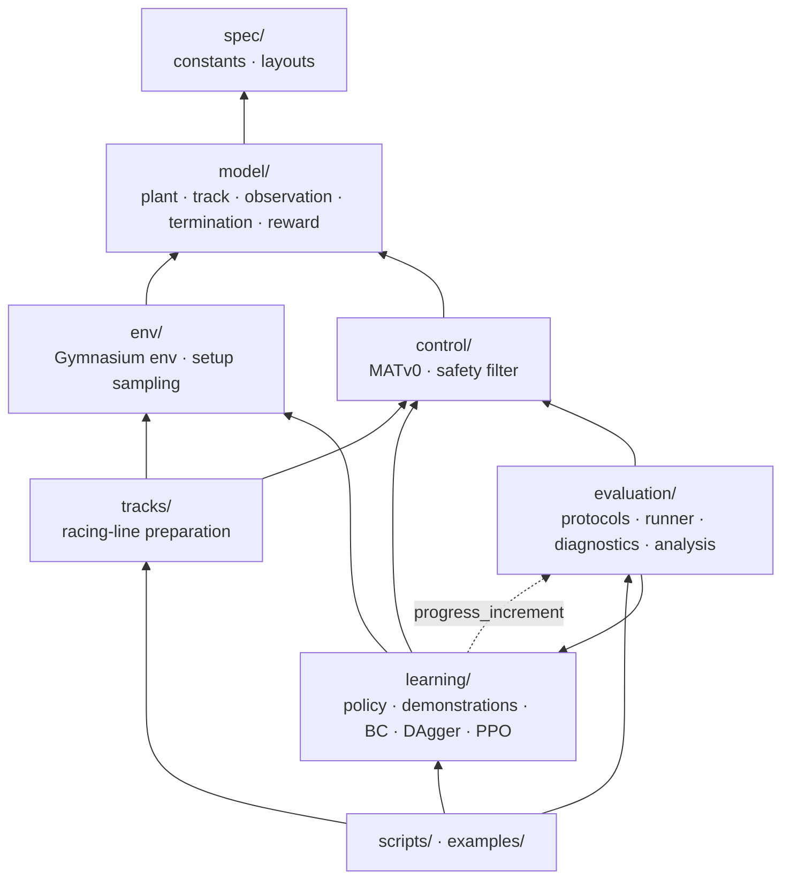

---

## 1. Vehicle plant — `model/`

The car is a **single-track (bicycle) model** written in the **Frenet frame** of the racing line. The racing line plays the role of the "centreline" of the Frenet frame: the car is described by how far along the line it is (`s`), how far to its side (`e_y`) and how its heading differs from the line's (`e_psi`). The plant is pure NumPy/SciPy with no Gymnasium dependency, and every quantity is float64.


| File                     | Content                                                                                                                                       |
| ------------------------ | --------------------------------------------------------------------------------------------------------------------------------------------- |
| `model/state.py`         | `VehicleState` (7 states), `VehicleMemory` (previous-step forces for load transfer), `SetupVector` (7 setup parameters), `AdmissibilityError` |
| `model/actuator.py`      | first-order steering lag                                                                                                                      |
| `model/tires.py`         | slip angles, combined-slip capacity, Pacejka lateral force, peak slip angle `alpha_sat`                                                       |
| `model/load_transfer.py` | longitudinal load transfer from the previous step                                                                                             |
| `model/powertrain.py`    | rear-wheel drive, brake bias, friction limit on the longitudinal forces                                                                       |
| `model/dynamics.py`      | `step_plant`: one 10 ms step in causal order                                                                                                  |
| `model/track.py`         | `RealTrack`: periodic-spline racing line (see section 2)                                                                                      |
| `model/observation.py`   | the 116-entry observation (see section 4)                                                                                                     |
| `model/sensors.py`       | accelerometer channels (specific force `F_body / m`), not part of the observation                                                             |
| `model/student.py`       | student observations S1 and S2 built from the logged channels (see section 4)                                                                 |
| `model/termination.py`   | track excursion, slip saturation, low speed                                                                                                   |
| `model/reward.py`        | reward (PPO fine-tuning, offline datasets) and traction cost                                                                                  |
| `spec/constants.py`      | every number of the model, with its unit                                                                                                      |

**Fixed vehicle data** (`spec/constants.py`): `l_f = 1.2 m`, `l_r = 1.4 m`, `I_z = 1800 kg m²`, `A_MAX = 8 m/s²`, `D_MAX = 12 m/s²`, front brake share `BETA_BRAKE = 0.65`, steering limit `DELTA_MAX = 0.5 rad`, integration step `DT = 0.01 s` (100 Hz, explicit Euler).

### One plant step

`step_plant(state, action, setup, memory, track, dt)` advances the car by one step. The order is causal: the load transfer uses the forces of the **previous** step, so there is no algebraic loop.

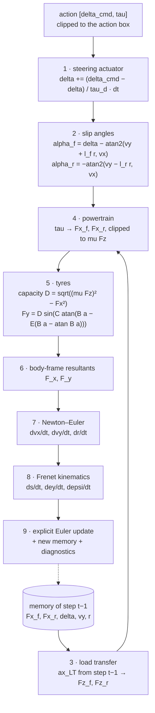

The equations, as implemented:

```
actuator      delta'   = clip(delta + (delta_cmd - delta) / tau_d * dt, ±0.5)
load transfer ax_LT    = (Fx_r,prev + Fx_f,prev cos delta_prev) / m + vy_prev r_prev
              Fz_f     = m / L (g l_r - ax_LT hcg),     Fz_r = m / L (g l_f + ax_LT hcg),     L = l_f + l_r
powertrain    tau >= 0: Fx_f = 0,                       Fx_r = tau m A_MAX
              tau <  0: Fx_f = tau m D_MAX 0.65,        Fx_r = tau m D_MAX 0.35
              |Fx_i| <= mu Fz_i
dynamics      dvx/dt = F_x / m + vy r,    dvy/dt = F_y / m - vx r,    dr/dt = (l_f (F_y - Fy_r) - l_r Fy_r) / I_z
Frenet        ds/dt  = (vx cos e_psi - vy sin e_psi) / (1 - kappa(s) e_y)
              de_y/dt = vx sin e_psi + vy cos e_psi,      de_psi/dt = r - kappa(s) ds/dt
```

The plant raises `AdmissibilityError` if an axle load becomes non-positive or if `1 − kappa e_y ≤ 0` (the Frenet frame becomes singular). The environment turns this into a clean termination.

### Tyres

Each axle has a Pacejka "magic formula" lateral force. `C` and `E` are the identified AV-24 shape and curvature factors (Jardali et al.); `B` is calibrated so that the force peaks at about 0.12 rad (front) and 0.13 rad (rear). The peak `D` is the **combined-slip capacity**: the longitudinal force has priority, and the lateral force gets what is left of the friction circle `mu Fz`.


Two thresholds are derived from the peak slip angle `alpha_sat` (computed once per episode at reset, `compute_saturation_threshold`):

- the **safety filter** treats `|alpha| > alpha_sat` as unsafe (factor 1.0);
- the **environment** terminates the episode at `|alpha| > 1.25 alpha_sat` (`SLIP_TERMINATION_RATIO`).

### Termination — `model/termination.py`

After every step the episode terminates on the first of:

| Event                     | Condition                                                      |
| ------------------------- | -------------------------------------------------------------- | ------- | ---------------------- | ------- | ------------------- |
| `track_excursion`         | `e_y` beyond the boundary distance on its side at `s` (left edge for `e_y > 0`) |
| `slip_saturation`         | `                                                              | alpha_f | > 1.25 alpha_sat,f`or` | alpha_r | > 1.25 alpha_sat,r` |
| `low_speed`               | `vx < V_MIN = 1 m/s`                                           |
| `admissibility_violation` | the plant raised `AdmissibilityError` (set by the environment) |

A completed lap does **not** terminate the episode: the episode runner, the demonstration generator and the PPO wrapper each decide when a lap is over by integrating the wrap-corrected progress (`evaluation/episode.py:progress_increment`).

---

## 2. Tracks and racing lines — `model/track.py`, `tracks/`

### The track object

`RealTrack(npz_path)` loads a racing-line NPZ and builds periodic cubic splines of every quantity, so every query wraps around the lap:

| NPZ key                       | Meaning                                                                | Accessor                                                         |
| ----------------------------- | ---------------------------------------------------------------------- | ---------------------------------------------------------------- |
| `s_m`, `track_length`         | arc length, lap length                                                 | `track_length`                                                   |
| `x_m`, `y_m`                  | world coordinates of the line                                          | `centerline_point(s)`                                            |
| `psi_rad`                     | heading (splined after removing the ±2π-per-lap trend)                 | `psi_ref(s)`                                                     |
| `kappa_radpm`                 | signed curvature                                                       | `kappa(s)`                                                       |
| `v_ref_mps`, `ax_mps2`        | speed profile (at `mu = 0.9`) and its acceleration                     | `v_ref(s)`, `ax_ref(s)`                                          |
| `w_tr_right_m`, `w_tr_left_m` | distances from the line to the track edges (floored at 5 m by default) | `boundary_right/left(s)`, `ey_max(s)`, `is_out_of_bounds(ey, s)` |

The speed profile is computed at the reference friction `mu = 0.9`; the observation rescales it by `sqrt(mu / 0.9)` to the episode's friction.

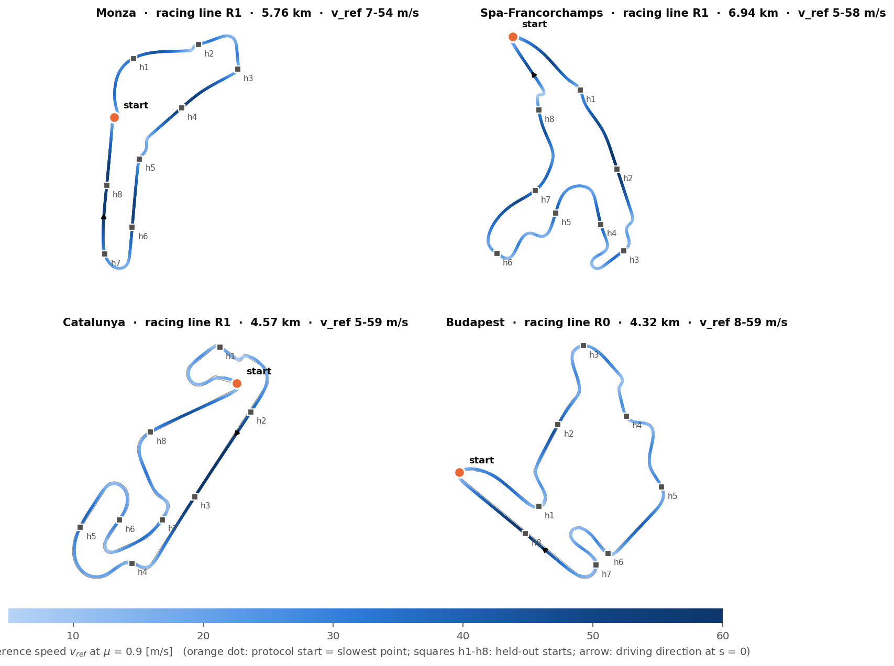

### Preparation chain

Every circuit goes through the same chain (`tracks/__init__.py`), driven by `scripts/prepare_tracks.py --circuit <name> --steps ...`:

```mermaid
flowchart LR
    A["tum_centerline.csv<br/>TUM racetrack database"] -- "reference.build_reference" --> B["reference.npz<br/>centreline, kappa, widths,<br/>kinematic v_ref"]
    B -- "raceline.build_racing_line<br/>(Monza: stored time-optimal line)" --> C["minimum_curvature_line.npz<br/>min ∫kappa² + point-mass speed"]
    C -- "speed_profile.fit_speed_profile<br/>8 iterations × 5 laps (~1 h)" --> D["speed_profile_probed.npz<br/>teacher-probed v(s)"]
    D -- "speed_profile.scale_profile<br/>× 0.9 (Monza × 0.83)" --> E["racing_line_R0.npz"]
    E -- "repair.repair_racing_line<br/>(not Budapest)" --> F["racing_line_R1.npz"]
```

| Step                   | Module                                  | How it works                                                                                                                                                                                                                                                                                                                                                   |
| ---------------------- | --------------------------------------- | -------------------------------------------------------------------------------------------------------------------------------------------------------------------------------------------------------------------------------------------------------------------------------------------------------------------------------------------------------------- |
| Reference              | `tracks/reference.py`                   | Loads the TUM CSV (`x, y, w_right, w_left`), computes arc length, heading and a smoothed curvature, and a kinematic profile `v = clip(0.85 sqrt(mu g / max(abs(kappa), 0.002)), 0, 90)`.                                                                                                                                                                       |
| Minimum-curvature line | `tracks/raceline.py`                    | Displaces the centreline along its normal by offsets `alpha_i` (1 m from the edges) that minimise the linearised squared curvature (bound-constrained least squares, Heilmeier et al. 2020). The speed is a point-mass profile inside the friction circle, with forward/backward passes, scaled by 0.85.                                                       |
| Probed speed profile   | `tracks/speed_profile.py`               | Scales the point-mass profile by a per-bin factor starting at 0.7. Each iteration drives five laps (`mu` 0.8 … 1.2) with the baseline teacher through the safety filter. If all laps are robust, the factor rises where the rear slip ratio stays below 0.65; otherwise it drops in an 800 m window before each failure. The fastest robust iteration is kept. |
| R0                     | `tracks/speed_profile.py:scale_profile` | The probed profile × 0.9 (Monza × 0.83). Demonstrations are always generated on R0.                                                                                                                                                                                                                                                                            |
| R1                     | `tracks/repair.py`                      | Detects 2-sample **curvature kinks** (`abs(kappa) > 0.06 1/m` and more than twice the neighbours) and replaces a ±25/40/60 m window around each with a local minimum-curvature re-optimisation (L-BFGS-B on the discrete curvature). Everything outside the windows is copied bit-for-bit.                                                                     |

The kinks are why the zero-shot policies failed on R0: they are steps in the curvature preview that no training circuit contained. On R1 the leave-one-circuit-out policies are robust (see [RESULTS.md](docs/RESULTS.md)).

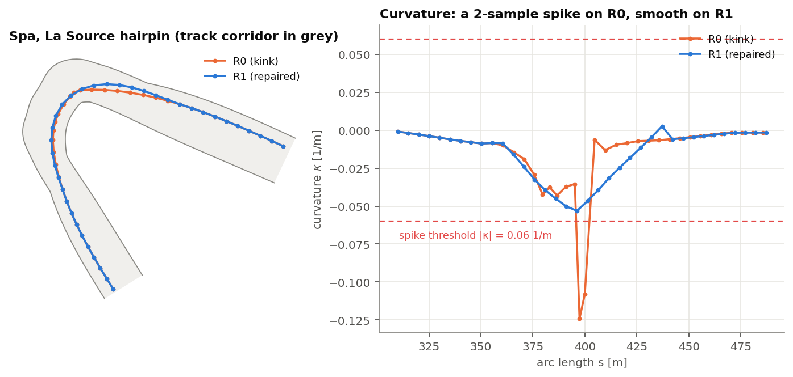

---

## 3. Environment — `env/`

`ContextualBicyclePacejkaEnv` (`env/environment.py`) is a thin Gymnasium wrapper around the plant. It holds one track; the vehicle setup changes per episode. `make_env(racing_line)` (`env/factory.py`) builds it on a racing-line NPZ (or a loaded `RealTrack`) and adds a `TimeLimit` of 100,000 steps (1000 s, far longer than any lap).

```python
from contextual_bicycle_pacejka.env.factory import make_env
from contextual_bicycle_pacejka.env.setup_sampling import randomized_setup
import numpy as np

env = make_env("data/tracks/spa/racing_line_R1.npz")
obs, info = env.reset(seed=42, options={
    "setup": randomized_setup(1.0, np.random.default_rng(42)),   # optional: sampled if absent
    "initial_s": 400.8,                                           # optional: 0 m
    "initial_vx": 4.6,                                            # optional: 5 m/s
})
obs, reward, terminated, truncated, info = env.step(np.array([0.0, 0.5], dtype=np.float32))
```

**Reset.** Draws (or receives) the setup and validates it, places the car on the racing line at `initial_s` with `e_y = e_psi = vy = r = delta = 0` and speed `initial_vx`, zeroes the memory, computes `alpha_sat` of both axles and returns the first observation. `info` holds the setup and the two `alpha_sat`.

**Step.** The sequence below is the whole environment logic:

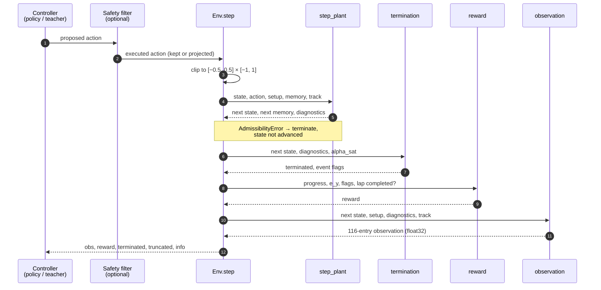

`info` contains `event_flags`, the plant `diag` (`ax, alpha_f, alpha_r, Fx_*, Fy_*, Fz_*, s_dot, ...`), the raw `state` and `setup`, `lap_complete`, the `traction_cost` of the step and the accelerometer channels `imu` of the returned observation (`imu` is also in the `info` of a reset, where it is zero).

### Domain randomisation — `env/setup_sampling.py`

Every episode has its own setup `xi = [m, Cz_f, Cz_r, mu, hcg, tau_d, Cpac]`, each entry drawn uniformly and independently:

| Entry          | Meaning                  | Range                       | Used by the plant         |
| -------------- | ------------------------ | --------------------------- | ------------------------- |
| `m`            | mass                     | 980 – 1820 kg (1400 ± 30 %) | yes                       |
| `Cz_f`, `Cz_r` | cornering stiffness      | 60,000 – 100,000 N/rad      | no (sampled and observed) |
| `mu`           | peak tyre-road friction  | 0.8 – 1.2                   | yes                       |
| `hcg`          | centre-of-gravity height | 0.4 – 0.6 m                 | yes (load transfer)       |
| `tau_d`        | steering lag             | 0.01 – 0.05 s               | yes (actuator)            |
| `Cpac`         | Pacejka shape factor     | 1.17 – 1.43                 | no (sampled and observed) |

Demonstrations and evaluations use `randomized_setup(mu, default_rng(seed))`: the setup is drawn from the seed and its friction is then **overwritten** by the scheduled `mu`. This decouples friction (the main factor) from the other parameters and makes every episode reproducible from `(mu, seed)`.

---

## 4. The learning problem: state, observation, action, reward

Seen as a reinforcement-learning problem, the task is a **contextual MDP**: the context is the setup `xi`, sampled at reset and constant within the episode.

| Element     | Definition                                                        | Where                                        |
| ----------- | ----------------------------------------------------------------- | -------------------------------------------- |
| Plant state | `z = [s, e_y, e_psi, vx, vy, r, delta]` + one-step memory         | `model/state.py`                             |
| Context     | `xi = [m, Cz_f, Cz_r, mu, hcg, tau_d, Cpac]`, uniform per episode | `env/setup_sampling.py`                      |
| Observation | 116 float32 entries, including the normalised `xi`                | `model/observation.py`, `spec/layout.py`     |
| Action      | `[delta_cmd, tau] ∈ [−0.5, 0.5] rad × [−1, 1]`                    | `spec/layout.py`                             |
| Transition  | deterministic `step_plant`, 10 ms explicit Euler                  | `model/dynamics.py`                          |
| Reward      | progress − lateral − time cost − failure penalty                  | `model/reward.py`                            |
| Termination | excursion, slip saturation, low speed, inadmissibility            | `model/termination.py`                       |
| Truncation  | `TimeLimit` (100,000 steps; PPO: 1.5 laps at 6 m/s)               | `env/factory.py`, `learning/ppo_finetune.py` |

The dynamics are deterministic: all the randomness is in the setup, the start and (for demonstrations) the observation noise.

### State

The **plant state** `z` (float64) lives in the Frenet frame of the racing line:

| Index | Symbol  | Unit  | Meaning                                                              |
| ----- | ------- | ----- | -------------------------------------------------------------------- |
| 0     | `s`     | m     | arc length along the racing line (not wrapped: it grows across laps) |
| 1     | `e_y`   | m     | lateral distance from the line, positive to the left                 |
| 2     | `e_psi` | rad   | heading of the car minus heading of the line                         |
| 3     | `vx`    | m/s   | longitudinal velocity in the body frame                              |
| 4     | `vy`    | m/s   | lateral velocity in the body frame                                   |
| 5     | `r`     | rad/s | yaw rate                                                             |
| 6     | `delta` | rad   | actual (post-actuator) steering angle                                |

The plant also keeps a **memory** of the previous step (`Fx_r, Fx_f, delta, vy, r`) for the load transfer. The controllers never see `s` directly or the memory: they see the observation.

### Observation (116 entries)

The observation is assembled by `build_observation` after every step. It is what the teacher and the policy read. Its layout is fixed in `spec/layout.py` (`OBS.*` indices):

| Index   | Content                                                                                  | Scaling                |
| ------- | ---------------------------------------------------------------------------------------- | ---------------------- |
| 0–2     | `vx, vy, r`                                                                              | m/s, m/s, rad/s        |
| 3       | `delta` (actual steering angle)                                                          | rad                    |
| 4–5     | `e_y, e_psi`                                                                             | m, rad                 |
| 6–17    | `v_ref` at 12 look-ahead distances 5, 10, 20, 35, 55, 80, 110, 145, 185, 230, 290, 350 m | m/s × `sqrt(mu / 0.9)` |
| 18–77   | 30 racing-line points 5–230 m ahead, `(x, y)` in the vehicle frame                       | m / 100                |
| 78      | `ax` of the last step                                                                    | m/s²                   |
| 79–85   | normalised setup `xi` (**privileged information**)                                       | affine to [−1, 1]      |
| 86–87   | lateral / longitudinal force use `ΣF / (mu m g)`                                         | clipped to [0, 1.5]    |
| 88–99   | curvature at the 12 look-ahead distances                                                 | (1/m) / 0.05           |
| 100–111 | reference acceleration at the 12 look-ahead distances                                    | (m/s²) / 15            |
| 112–113 | slip angles `alpha_f, alpha_r`                                                           | rad / 0.40             |
| 114–115 | `Fy_f / (mu Fz_f)`, `Fy_r / (mu Fz_r)`                                                   | clipped to [−1, 1]     |

The observation therefore contains the **true setup**: the controller knows the mass, the friction and the actuator lag of the car it drives. Estimating them from history was tried and abandoned (see [HISTORY.md](docs/HISTORY.md)). The policy additionally passes the observation through a frozen `VecNormalize` (per-entry mean and standard deviation of the training data).

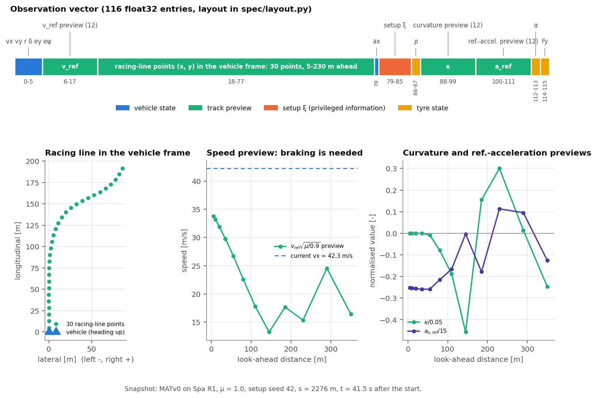

### Student observation — `model/student.py`, `env/student.py`

The 116-entry observation is **privileged**: the teacher, the safety filter and the critics read it. The students of the redesign ([REDESIGN.md](docs/REDESIGN.md)) see less, in levels that are added one at a time:

| Level | Withholds                                                                                     | Sees                                                                                         |
| ----- | --------------------------------------------------------------------------------------------- | -------------------------------------------------------------------------------------------- |
| S0    | nothing                                                                                       | the privileged observation                                                                   |
| S1    | the setup `xi`, the friction scaling of the `v_ref` preview, the force use, `ax = dvx/dt`     | `vx, r, delta`, accelerometer `ax_imu, ay_imu`, `e_y, e_psi`, previous action, `vy, alpha_f, alpha_r`, previews |
| S2    | also `vy` and the slip angles                                                                 | the S1 channels without `vy, alpha_f, alpha_r`                                               |

The privileged observation leaks the setup in three places besides `xi`: the `v_ref` preview is scaled by `sqrt(mu / 0.9)`, the force-use entries are divided by `mu m g` and `mu Fz`, and `ax = dvx/dt` contains `vy`. S1 and S2 receive the preview at the reference friction and the accelerometer's specific force `F_body / m` instead (`model/sensors.py`).

A student observation stacks 8 frames of the dynamic channels, 5 steps apart (the last 0.35 s), with the previews of the current step: 9 × 8 + 96 = 168 entries for S2, 12 × 8 + 96 = 192 for S1 (layout in `spec/layout.py`). It is a function of the logged channels (privileged observation, `imu`, previous executed action) rounded to float32. The student built offline from a dataset (`learning/datasets.py:student_dataset`) therefore equals the one built online by the `StudentObservation` wrapper (`make_student_env`), bit for bit.

The history is a parameter of the layout (`student_layout(level, n_frames, stride)`): 8 frames 50 steps apart cover the last 3.5 s with the same width. A **diagnostic** layout may also append privileged oracle entries after the previews (`oracle=("mu",)`: the raw episode friction, one more entry). It measures how much of the gap to S0 one withheld quantity explains; a student meant to drive never reads it. Level `C` is the observation of the coach (section 8.8): the privileged observation without the plan of the teacher, that is without the `v_ref` and reference-acceleration previews (92 entries, `COACH_INDEX`). At evaluation, `oracle_offset={"mu": -0.05}` (`evaluate.py --oracle-offset mu=-0.05`) adds a constant error to the oracle entry, which measures how accurate an estimate of the quantity must be. With `oracle_clip=True` (`--oracle-clip`) the entry is then clipped to the range an estimate can take (`ORACLE_RANGES`: `mu` in [0.8, 1.2]), so the test covers only errors a friction estimator can make. A plan scale `c` (`plan_scale`, `evaluate.py --plan-scale`) multiplies the `v_ref` preview a student reads: a constant scale of the teacher's plan, or the scale a plan coach chooses (section 8.9).

### Action

| Index | Symbol      | Range           | Meaning                                                                                               |
| ----- | ----------- | --------------- | ----------------------------------------------------------------------------------------------------- |
| 0     | `delta_cmd` | [−0.5, 0.5] rad | steering **command**; the actual angle follows with lag `tau_d`                                       |
| 1     | `tau`       | [−1, 1]         | `tau ≥ 0`: throttle, rear force `tau m A_MAX`; `tau < 0`: brake, `tau m D_MAX` split 65/35 front/rear |

The environment clips actions to this box. The safety filter adds a steering-rate limit of 6 rad/s on the command (0.06 rad per step).

### Reward — `model/reward.py`

Behaviour cloning and evaluation **ignore the reward**: the policy is trained by regression on teacher labels and scored by lap outcomes. The reward is used by the (paused) PPO fine-tuning and logged in the offline datasets:

```
r_t = w_progress · max(ds/dt, 0) · dt                       progress along the racing line [m]
    − w_lateral  · (|e_y| / e_y,max(s))² · dt                stay near the line
    − 12 · dt                                                time cost: 1 s costs 12 m
    − w_traction · c_t · dt                                  traction cost (see below)
    + lap_bonus  · 1[lap completed]
    − 1[failure] · (3 + w_crash · (vx² + vy²))               one-off failure penalty

c_t = Σ_axles max(|alpha_i| / alpha_sat,i − 0.9, 0)          slip beyond 90 % of the peak slip angle
```

| Weight                 | Default | Unit |
| ---------------------- | ------- | ---- |
| `w_progress`           | 1.0     | –    |
| `w_lateral`            | 1.0     | m    |
| `lap_bonus`            | 0.0     | m    |
| `w_crash`              | 0.02    | s²/m |
| `w_traction`           | 0.0     | m/s  |
| `TIME_COST_RATE`       | 12.0    | m/s  |
| `CRASH_BASE`           | 3.0     | m    |
| `TRACTION_SLIP_MARGIN` | 0.9     | –    |

The traction cost measures how far a tyre is driven past its peak. The combined-slip capacity keeps every axle force inside the friction circle, so the force use never exceeds 1; beyond `alpha_sat` the lateral force falls instead. It is a cost, not a reward: rewarding the use of the friction budget made an earlier agent brake to collect it (HISTORY.md, section 1). The environment reports `c_t` in `info["traction_cost"]` whatever its weight. The offline datasets log the reward with `OFFLINE_REWARD_WEIGHTS` (no lateral term, no traction term) and the cost separately, so that its weight is chosen at training time. On the certified teacher's healthy laps the cost is zero: the teacher stays below 90 % of the peak slip angle.

A failure is any of the four termination events. With `w_progress = 1` and episodes ending at the first lap, the return of a clean lap is about `L − 12 T` (lap length minus 12 × lap time), so **a faster lap is a higher return**, and crashing at high speed costs more than crashing slowly. On a teacher lap the lateral term is negligible (−3 over a lap of 5.8 km):

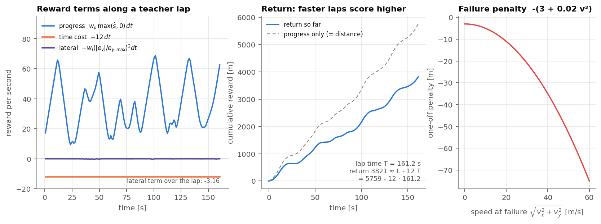

---

## 5. Teacher: MATv0 — `control/teacher.py`

MATv0 (model-aware teacher, version 0) generates every training label. It is a **stateless** controller that reads only the 116-entry observation, so it can label any visited state. It is a classical baseline plus three switchable modules; the certified configuration (`data/teacher/matv0.json`) is `k = 1.25` with T, L and Y on.

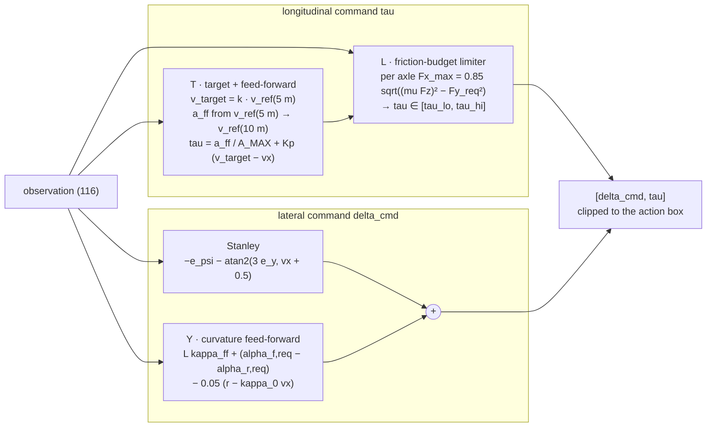

| Module                                     | Purpose                                                    | How                                                                                                                                                                                       |
| ------------------------------------------ | ---------------------------------------------------------- | ----------------------------------------------------------------------------------------------------------------------------------------------------------------------------------------- |
| baseline                                   | track the line and a speed target                          | Stanley steering `−e_psi − atan2(3 e_y, max(vx, 0.5) + 0.5)`; speed P-controller (gains 0.15 throttle, 0.25 brake) on `k · min(v_ref, 5–55 m)`                                            |
| **T** target + feed-forward                | brake and accelerate on time                               | target `k · v_ref(5 m)`, feed-forward `a_ff = (v(10 m)² − v(5 m)²) / (2 · 5 m)` normalised by `A_MAX` or `D_MAX`                                                                          |
| **L** friction-budget limiter              | never ask an axle for more than its friction circle allows | decodes `m, mu, hcg` from `xi`, predicts `Fz` with the load-transfer equation, and bounds `tau` so that each axle keeps 85 % of `sqrt((mu Fz)² − Fy_req²)`                                |
| **Y** curvature feed-forward + yaw damping | steer into the corner before the error appears             | kinematic `L · kappa` plus the slip-angle difference needed for `ay = kappa vx²`, with `kappa` taken at `vx · tau_d` ahead (actuator-lag lead); yaw-rate damping `−0.05 (r − kappa_0 vx)` |

The teacher uses the privileged setup (`xi` in the observation) in L and Y. With all switches off it is exactly the earlier production teacher; the speed-profile probe still uses that form.

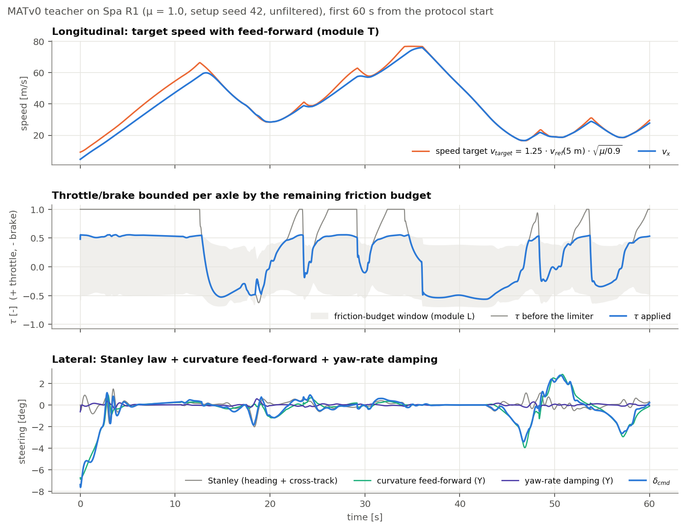

In the figure, the speed lags the target only while accelerating: there the limiter (L) caps the throttle at about 0.55, the rear axle's remaining friction budget. The steering is mostly feed-forward (Y): the Stanley term only corrects small residual errors.

---

## 6. Safety filter — `control/safety_filter.py`

The safety filter (a **shield**) sits between a controller and the environment. At every step it computes the set of safe actions from the **true plant state** (an oracle: state, memory, setup and track) and replaces an unsafe proposal by the nearest safe one. It is used:

- always, to produce the demonstration labels and executed actions;
- in the behaviour-cloning gate and in DAgger collection;
- in the evaluation condition **F** (filtered), never in **U** (unfiltered).

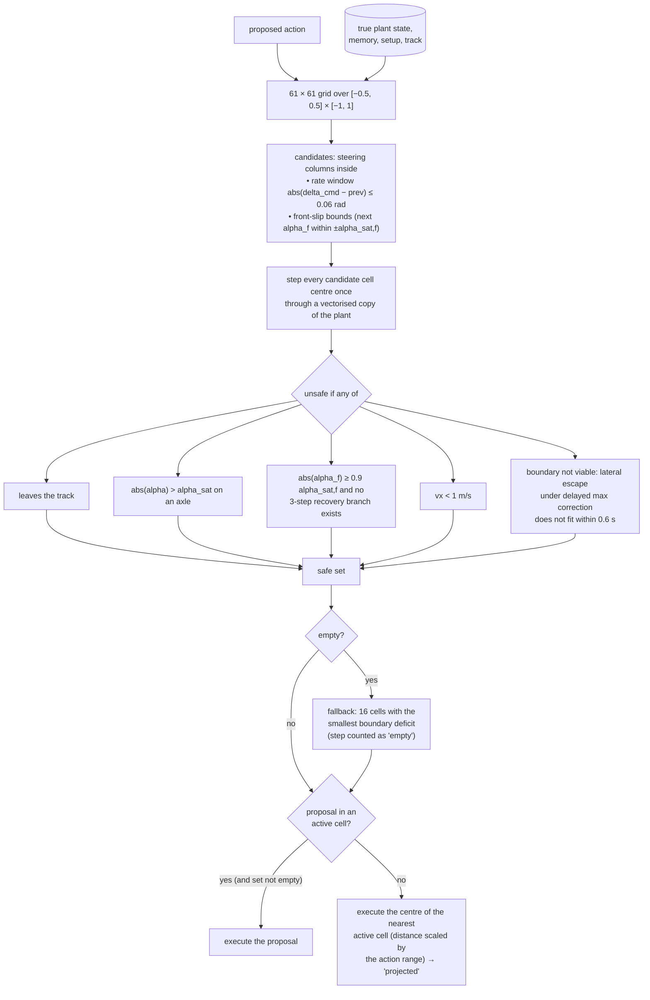

| Parameter                  | Value   | Meaning                                                                                      |
| -------------------------- | ------- | -------------------------------------------------------------------------------------------- |
| `N_CELLS`                  | 61      | grid cells per action dimension                                                              |
| `STEERING_RATE_LIMIT`      | 6 rad/s | steering-command rate limit                                                                  |
| `FRONT_SLIP_MARGIN`        | 0.9     | front slip above 0.9 `alpha_sat,f` needs a recovery check                                    |
| `FRONT_SLIP_ROLLOUT_STEPS` | 3       | depth of the recovery tree (3 steering branches per node, zero throttle, `abs(delta) ≤ 0.2`) |
| `BOUNDARY_HORIZON_S`       | 0.6 s   | look-ahead of the boundary-viability check                                                   |
| `SAFETY`                   | 0.86    | fraction of the lateral capacity available for the escape manoeuvre                          |
| `FALLBACK_CELLS`           | 16      | cells activated when the set is empty                                                        |

`filter_action(env, proposed, previous_action)` returns a `FilterResult(action, projected, empty)`. An episode with any `empty` step is not counted as **robust**.

The filter is a one-step check, so on most steps the whole candidate band is safe and the filter only enforces the steering-rate window; when the car is already committed to a failure, the set can collapse to the fallback. The figure shows both at a real state, with a policy that does not know Spa:

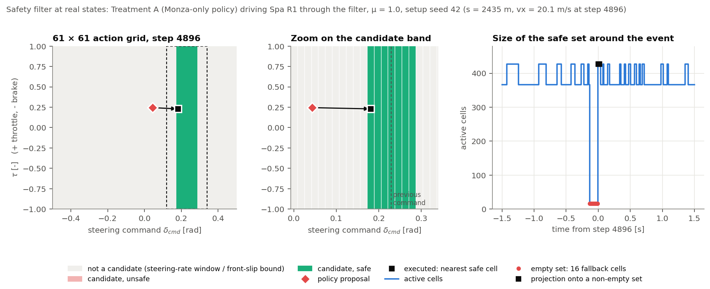

---

## 7. The policy — `learning/policy.py`

A policy directory (`models/<name>/`) contains:

- `policy.zip`: a Stable-Baselines3 `ActorCriticPolicy` archive;
- `vecnormalize.pkl`: the observation normaliser, fitted once on the training observations and then frozen (mean and variance are summed by chunks in numpy's order, `statistics.column_moments`: the same normaliser, without a float64 copy of a large dataset);
- `training.json` and `gate.json`: the training result and the gate laps.

The controller is the **deterministic actor mean**:

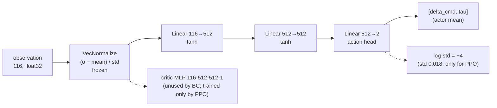

```python
from contextual_bicycle_pacejka.env.factory import make_env
from contextual_bicycle_pacejka.learning.policy import Policy

env = make_env("data/tracks/spa/racing_line_R1.npz")
policy = Policy("models/all4", env)
obs, _ = env.reset(seed=42)
action = policy(obs)          # [delta_cmd (rad), tau (-1 brake ... 1 throttle)], not clipped
```

The actor-critic class is reused from SB3 so that PPO fine-tuning can start from the same archive; behaviour cloning trains only the actor MLP and the action head. `load_model` maps the class names of the original archives onto the standard SB3 classes.

A **student policy** has the same network on the student observation of its level (192 entries for S1, 168 for S2), and its directory also holds `student.json` with the level, the frame history, the oracle entries (diagnostic layouts only) and the training target. `policy_layout(model_dir)` reads it; a directory without it, such as every policy in `models/`, is a privileged (S0) policy. `policy_env(raceline, layout)` builds the environment the policy expects: `make_env` for S0, so S0 runs are unchanged, and `make_student_env` otherwise.

The behaviour-cloned policy reproduces the teacher closely, on states it visits itself:

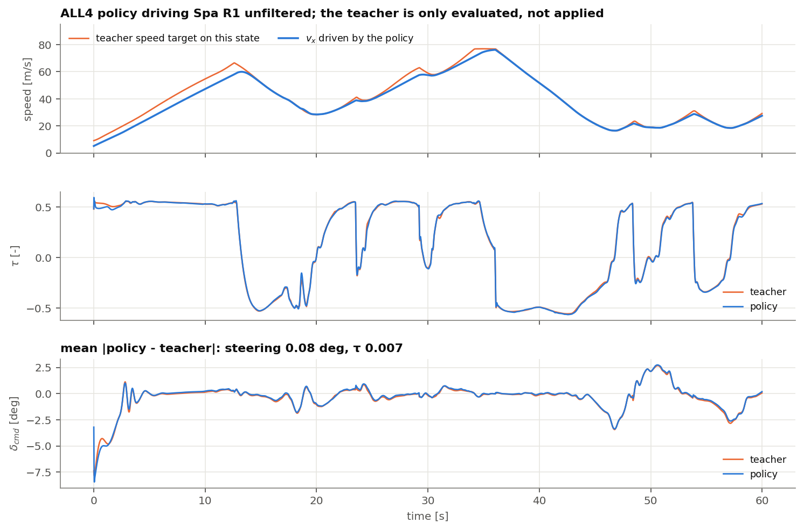

---

## 8. Training — `learning/`

### 8.1 Perturbed demonstrations — `learning/demonstrations.py`

Cloning clean teacher laps fails: the teacher brakes by **speed-error feedback**, but clean laps contain almost no speed error, so the clone learns an open-loop braking schedule (see [HISTORY.md](docs/HISTORY.md), section 3). The fix is to **drive the car off-nominal and record the teacher's correction there**. At every step the teacher is evaluated twice:

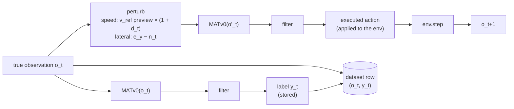

| Item                      | Value                                                                                                                               |
| ------------------------- | ----------------------------------------------------------------------------------------------------------------------------------- |
| Laps per circuit and kind | 20, with `mu` from a balanced permutation of {0.8, 0.9, 1.0, 1.1, 1.2} and setup `randomized_setup(mu, rng)` from `default_rng(42)` |
| Start                     | the slowest point of `v_ref`, at `max(0.9 v_ref,min, 1) · sqrt(mu / 0.9)`                                                           |
| `speed` kind              | `d_t`: Ornstein–Uhlenbeck, correlation time 2 s, sigma 0.08, clipped to ±0.16                                                       |
| `lateral` kind            | `n_t`: Ornstein–Uhlenbeck, correlation time 2 s, sigma 0.25 m, clipped to ±0.5 m                                                    |
| `speed_wide` kind         | as `speed`, sigma 0.16 clipped to ±0.32, with its own noise seeds (failures for the offline datasets)                               |
| `lateral_wide` kind       | as `lateral`, sigma 0.5 m clipped to ±1.0 m, with its own noise seeds                                                               |
| `none` kind               | the clean teacher lap (used by the tests and DAgger's base data)                                                                    |
| Racing line               | always R0                                                                                                                           |
| Kept lap                  | completed, no termination event, no empty-safe-set step; otherwise retried with the next noise draw (up to 10 attempts; a `none` lap is deterministic and gets one) |

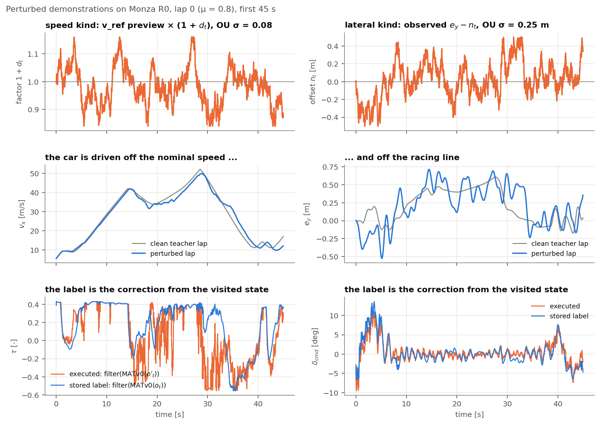

The executed action (orange) is the teacher reacting to a wrong view of the world; the label (blue) is what the teacher would do from the state the car is actually in.

For the offline datasets every step also logs the accelerometer channels of the observation, the reward (with `OFFLINE_REWARD_WEIGHTS`), the traction cost and whether the filter replaced the teacher's action in the label. Once per lap it logs the observation after the last step, and the summary records whether the lap ended by a failure (`terminated`) and the teacher's speed factor. With `keep_failed` (`--keep-failed`), the attempts that are not kept are saved as `lapNN_attemptKK.npz`; they are the failures of the offline datasets. A teacher speed factor other than 1.25 (`--speed-safety`) writes to its own folder, `<kind>_k<factor>`; it changes both the labels and the executed actions. An execution speed factor (`--exec-speed-safety`, `exec_teacher`) changes only the teacher that drives the lap, so the lap runs slower or faster while the labels stay those of the certified teacher (mixed-speed laps, folder `<kind>_x<factor>`). None of this changes the actions, labels or observations of the existing kinds.

### 8.2 Datasets — `learning/datasets.py`

A dataset concatenates, per training circuit (Monza, Spa, Catalunya, Budapest, in this order), the kept speed laps followed by the kept lateral laps. Each NPZ holds `observations` (N × 116, float32), `actions` (the labels, N × 2), `episode_ends` and per-lap metadata (`start_s_per_lap`, `start_vx_per_lap`, `mu_per_lap`, `setup_per_lap`).

| Dataset            | Circuits                         | Laps | Transitions |
| ------------------ | -------------------------------- | ---- | ----------- |
| `treatment_a`      | Monza                            | 40   | 636,330     |
| `all4`             | Monza, Spa, Catalunya, Budapest  | 121  | 2,125,754   |
| `loco_spa`         | all but Spa                      | 93   | 1,518,350   |
| `loco_catalunya`   | all but Catalunya                | 89   | 1,590,650   |
| `loco_budapest`    | all but Budapest                 | 100  | 1,778,838   |
| `clean_laps_monza` | Monza, `none` kind (DAgger base) | 20   | 315,092     |

An **offline (MDP) dataset** (`assemble_mdp`, `build_dataset.py --mdp`) adds the transitions of the laps:

| Key                                      | Shape            | Content                                                                    |
| ---------------------------------------- | ---------------- | -------------------------------------------------------------------------- |
| `observations`, `imu`                    | N × 116, N × 2   | privileged observation `o_t` and its accelerometer channels                |
| `actions`                                | N × 2            | teacher label (behaviour cloning reads an MDP dataset unchanged)           |
| `actions_exec`                           | N × 2            | executed action `a_t`, the one that produced `o_t+1`                       |
| `rewards`, `traction_costs`              | N                | reward and traction cost of the transition                                 |
| `terminals`, `timeouts`                  | N                | 1 at the last transition of a lap ended by a failure / by completion or step limit |
| `final_observations`, `final_imu`        | E × 116, E × 2   | state after the last transition of each of the E laps                      |
| `*_per_lap`                              | E                | start, `mu`, setup, circuit, kind, attempt, healthy, speed factors of the labelling and of the driving teacher |

The next state of transition `t` is `o_t+1` inside a lap and the lap's final observation at its last transition. With the E final observations appended after the N transitions it is row `next_index(episode_ends)[t]`, so training keeps no second copy of the rows for the next states. `student_dataset` builds the student observations of a level, followed by those of the final states, from the same arrays.

### 8.3 Behaviour cloning — `learning/behaviour_cloning.py`

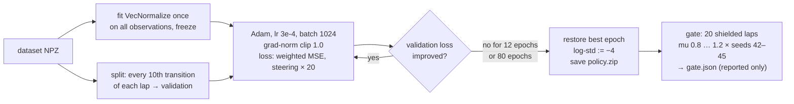

The loss on a batch `b` with per-sample weights `w_b` (all 1, except in DAgger) and per-action weights `lambda = [20, 1]` is

```
loss = Σ_b w_b Σ_j lambda_j (mu_theta,j(o_b) − y_b,j)² / (2 Σ_b w_b)
```

Steering is weighted 20× because its errors are small in radians but matter far more than throttle errors. Only the actor (`mlp_extractor.policy_net` and `action_net`) is optimised. The gate does not select the model: it reports whether 20 filtered laps from the dataset's first start pass. Every final policy passes 20/20.

Four settings extend the training to the students of the redesign; their defaults give the original training:

| Setting (`BCConfig`, `train_bc.py`) | Values                    | Effect                                                                                               |
| ----------------------------------- | ------------------------- | ---------------------------------------------------------------------------------------------------- |
| `level` (`--level`)                 | `S0` (default), `S1`, `S2` | observation; S1/S2 are built from an offline dataset by `datasets.student_dataset_observations`      |
| `target` (`--target`)               | `label` (default), `exec` | regression target: the teacher label (`actions`) or the executed action (`actions_exec`, offline dataset) |
| `n_frames`, `stride` (`--frames`, `--stride`) | `8`, `5` (default)     | frame history of S1/S2: `n_frames` frames `stride` steps apart                                      |
| `oracle` (`--oracle`)               | none (default), `mu`      | diagnostic: privileged entries appended to the S1/S2 observation                                     |

The normaliser is fitted on the observations of the level, and `student.json` records level, history, oracle and target.

### 8.4 Weighted DAgger (paused) — `learning/dagger.py`

An alternative to perturbed demonstrations, kept for reference. Each iteration: the current policy drives through the filter while the teacher labels every visited state; for each failed lap the labels of the last 100 m before the failure are kept (weight 80); the base data keep weight 1 but are relabelled with the policy's own outputs ("anchors"); BC continues from the current policy (lr 3e-5, 12 epochs); the gate decides whether to stop. It made the policy filter-dependent, because laps rescued by the filter produce no labels.

### 8.5 PPO fine-tuning (paused) — `learning/ppo_finetune.py`

This is the only stage that uses the reward. The BC policy is fine-tuned with PPO and a **decaying KL anchor** to the BC policy, to try to beat the teacher's pace without forgetting how to drive.

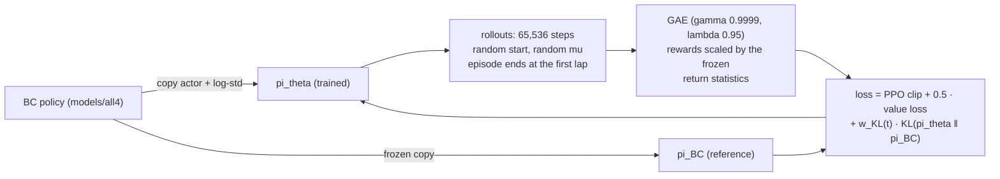

| Setting       | Value                                                                                                                                                                                               |
| ------------- | --------------------------------------------------------------------------------------------------------------------------------------------------------------------------------------------------- |
| Episodes      | start `s ~ U[0, L)`, `vx ~ U[5, 15] m/s`; `mu ~ N(1.0, 0.15)` clipped to [0.8, 1.2]; other setup entries sampled; terminate at the first completed lap (`is_success`); time limit 1.5 laps at 6 m/s |
| PPO           | 1M steps, `n_steps` 65,536, batch 1024, 3 epochs, lr 3e-5 → 1e-5 linear, clip 0.2, no entropy bonus, `target_kl` 0.03                                                                               |
| KL anchor     | `w_KL(t) = max(0.02, 0.1 · (1 − t / 1M))`                                                                                                                                                           |
| Normalisation | observation statistics of the BC normaliser (frozen); rewards normalised by `VecNormalize`                                                                                                          |

The pilot on Monza R1 (`models/ppo_pilot_all4_monza`) changed lap times by less than 0.13 %: with log-std −4 and no entropy bonus the actor never explored. See [HISTORY.md](docs/HISTORY.md), section 5.

### 8.6 Friction estimator — `learning/friction.py`

An S2 student given the true friction drives like the privileged policy ([REDESIGN.md](docs/REDESIGN.md), section 13.20): the only thing it lacks is `mu`. The friction estimator recovers `mu` from onboard sensors and takes its place in the `mu` oracle entry, in the manner of an adaptation module.

| Stage       | What it does                                                                                                                                                                                                                               |
| ----------- | ------------------------------------------------------------------------------------------------------------------------------------------------------------------------------------------------------------------------------------------ |
| Measurement | an MLP (128 × 2, SiLU) reads 8 frames, 5 steps apart, of the tyre channels `FRICTION_CHANNELS = (vx, r, delta, ax_imu, ay_imu)` and returns a Gaussian `N(m_t, s_t²)` for `mu`, trained with the Gaussian negative log-likelihood |
| Memory      | a scalar Kalman filter fuses one measurement every 10 steps, with the variance inflated by `c`: `K = P / (P + c s²)`, `mu_bar += K (m − mu_bar)`, `P *= 1 − K`. On a straight `s²` is large and the estimate is kept                     |
| Output      | the lower bound `mu_hat = clip(mu_bar − k sqrt(P + b²), MU_LO, MU_HI)`, `k ≥ 1`; the prior `N(1.0, 0.2²)` starts it at `MU_LO`                                                                                                          |

The tyre channels determine `mu` in a loaded corner: the accelerometer and the yaw acceleration give the axle forces, `delta − L r / vx` gives the difference of the slip angles, and the force is `mu Fz f(alpha)` with `f` fixed. Previews and actions are excluded, so the estimate cannot be read from how fast the car is driven. For the same reason the training data include teacher laps at lower speed factors (`none_k1.00`, `none_k1.10`), where pace and friction are decorrelated.

Errors cost asymmetrically: underestimating `mu` costs lap time, overestimating it by more than about 6 % costs the car (REDESIGN.md, section 13.23). The constants are calibrated on held-out setups (one per friction value):
- `c` minimises the negative log-likelihood of the true `mu` under `N(mu_bar, P)`;
- `b` is the root mean square of the end-of-lap error of `mu_bar` (with `bias_side="over"`, of its overestimates only: an underestimate is on the safe side and needs no margin);
- `k` is the smallest margin, at least 1, that keeps `mu_hat ≤ 1.03 mu` at every held-out step.

Two remedies for the feedback between estimate and policy (an overestimate makes the policy push harder, the states leave the training data and the estimate rises further) are available separately:

| Remedy                               | Module, script                                             | Effect                                                                                                                                    |
| ------------------------------------ | ---------------------------------------------------------- | ----------------------------------------------------------------------------------------------------------------------------------------- |
| Rise limit (inference only)          | `FrictionEstimator(dir, rise_limit)`, `evaluate.py --mu-rise-limit` | `mu_hat` rises by at most `rise_limit` per second and falls freely                                                                 |
| Closed-loop data (DAgger of the estimator) | `learning/closed_loop.py`, `scripts/collect_closed_loop.py` | an S2 + mu student drives laps reading the estimate (`muhat`) or `mu ± b`; the laps, labelled with the true `mu`, are added to the training data |

`train_friction.py --recalibrate DIR` copies a trained estimator and calibrates it again with other settings (`--bias-side over`, `--overestimate-limit`, `--margin-floor`: the smallest margin `k`, 1 by default; below 1 the estimate starts above the lower end of the friction range) without retraining, and `--patience` at least `--epochs` disables early stopping (the best validation state is kept). `train_friction.py` takes several datasets (concatenated in order) and reports the validation per kind of lap (`validation_by_kind`) and per circuit (`validation_by_circuit`; closed-loop laps record the circuit of their racing line). Training keeps only the frames of the tyre channels of every lap and standardises the input windows by chunks (`learning/statistics.py`), so a dataset of four circuits fits in memory, with the numbers of the whole-array computation. A later DAgger iteration drives with the estimator of the previous one, from new starts (`--seed`), and labels its laps apart (`--label closed_loop2`). Results in REDESIGN.md, sections 13.28–13.29, 13.31–13.32, 18 and 21 (an estimator trained on the four circuits).

An estimator directory holds `estimator.json` (configuration, input normalisation, calibration, validation report) and `estimator.npz` (weights). Inference is NumPy; the estimate of an episode computed offline (`estimate_episode`) equals the one computed online (`reset`, `update`) to rounding. `make_student_env(..., mu_estimator=FrictionEstimator(dir))` feeds it to a student with the `mu` oracle entry, and `info["oracle"]` reports the entry of every step.

### 8.7 Offline reinforcement learning — `learning/offline_rl.py`

The critic reads the privileged observation and the actor the student observation (asymmetric critic). The actor is the network of behaviour cloning, so an offline-RL policy is evaluated, and given a friction estimate, like a behaviour-cloned student. The transitions are those of an offline (MDP) dataset (section 8.2): the executed action, the offline reward, and `d = 1` only at a failure (completed laps are bootstrapped).

| Algorithm | Critic                                                                                       | Actor                                                                                                                    |
| --------- | -------------------------------------------------------------------------------------------- | ------------------------------------------------------------------------------------------------------------------------ |
| IQL       | `V(s)` by expectile regression (0.7) of `min Q_target(s, a)`; `Q(s, a) → r + γ (1 − d) V(s')` | advantage-weighted regression on the **executed** actions, weight `min(exp(β A / σ_A), 100)` with `σ_A` a running std of `A` |
| TD3+BC    | `Q(s, a) → r + γ (1 − d) min Q_target(s', clip(π_target(o') + noise))`                        | `− λ Q(s, π(o)) + BC(π(o), y)` on the teacher **labels** `y`, `λ = 2.5 / mean|Q|`, every second step                   |

Both use two Q networks (256 × 2, ReLU) on the normalised privileged observation and the action scaled to [−1, 1], Polyak targets (0.005), `γ = 0.995` (about 2 s at 100 Hz), batch 1024 and the BC loss of section 8.3 (steering × 20). The advantages are normalised because the rewards are metres per step. A policy directory holds the files of a behaviour-cloned student plus `critic.pt` and `offline_rl.json`: configuration, training curve (losses, Q, the actor's error to the executed actions and to the labels on held-out transitions), and a critic diagnostic. The diagnostic gives the fraction of held-out transitions, among those where label and executed action differ most, in which the critic prefers the label. With `--no-failures` (`OfflineRLConfig.failures=False`, an ablation) a failed lap is bootstrapped like a truncated one and its crash penalty is removed from the reward, so the critic cannot tell a failure from a lap cut short.

With `--cost-limit ρ` (`OfflineRLConfig.cost_limit`, TD3+BC only) the traction cost is a constraint. A second pair of Q networks estimates the discounted traction cost, `Q_c(s, a) → c + γ (1 − d) max Q_c,target(s', a')`, and a Lagrange multiplier `ν` keeps the batch mean of `Q_c(s, π(o))` within `ρ` times that of the labels on the same states. The actor loss gains `ν (2.5 / C) Q_c(s, π(o))`, with `C` a running mean of the labels' cost, and `ν` follows the relative violation (step `--cost-lr`, clipped to [0, 10]). The curve logs the cost critic, the multiplier and the violation, and `offline_rl.json` adds a cost diagnostic (the cost critic for the executed actions, the labels and the policy, on all held-out transitions and on those with a cost). Results in REDESIGN.md, section 19.

### 8.8 Coach — `learning/coach.py`

The students above drive at the teacher's pace: they read the teacher's plan (the `v_ref` preview) and track it ([REDESIGN.md](docs/REDESIGN.md), section 23). The coach is a privileged policy that chooses its speed itself: it reads the observation of level `C` (no `v_ref` or reference-acceleration preview) and is trained online, in the simulator, on the reward.

| Element     | Choice                                                                                                                                         |
| ----------- | ---------------------------------------------------------------------------------------------------------------------------------------------- |
| Decisions   | every 5 simulator steps (20 Hz), the action held: at 100 Hz the critic cannot tell actions apart (REDESIGN.md, section 24.3), and 20 Hz is the lowest rate at which the teacher loses nothing (24.4); a transition spans one decision, discount 0.99 per decision |
| Start       | from a policy of level `C` trained offline (`--init-policy`, e.g. BC on the labels), whose critic is first retrained at the decision rate on the prior data with the actor fixed, then online for a million steps with the actor still fixed: from scratch the coach fails (24.4) |
| Algorithm   | TD3, one update per decision; actor loss `− λ Q + w(t) BC(π(o), y) + trust` on the prior half of the batch, λ fixed at the end of the pretraining, the BC weight falling from 1 to 0 over the first 30 % of the training (offline-to-online), and a trust term towards the Polyak-averaged actor (24.11) |
| Exploration | on the friction the coach reads (Ornstein-Uhlenbeck, 5 %, 2 s), not on its actions: action noise of 0.005 already loses laps (24.8) |
| Prior data  | an offline MDP dataset in the replay, cut into 5-step windows with the mean executed action (pseudo-actions), half of every batch (RLPD); critics with layer normalisation |
| Guide       | optional (`guide_steps`, off by default): the teacher drives the first `h` decisions of an episode at its 100 Hz, `h` uniform in [0, H], H falling to 0 (JSRL) |
| Episodes    | uniform start on the lap at 50–100 % of the teacher's speed, `mu` uniform in [0.8, 1.2], own setup seeds, 3000 steps                            |
| Reward      | the reward of the offline datasets: progress, time cost, failure penalty, no lateral term; the traction cost is logged, not weighted              |
| Critic      | two Q networks on the full privileged observation                                                                                               |
| Actor       | the behaviour-cloning network on the `C` observation, so a coach is stored, loaded and evaluated like a student (`student.json`: level `C`, target `reward`) |
| Validation  | six fixed laps outside the protocols, at the start and every million steps, against the teacher, with the coach deciding at 100 Hz (as evaluated) and at 20 Hz |

`scripts/train_coach.py` trains one coach; `coach.json` holds the configuration, the training curve and the validations. Design and results in REDESIGN.md, section 24.

**Outcome.** Five designs did not learn (24.3–24.12). The measured cause: one 50 ms decision changes the return less than the error of the critic, so the actor follows noise, and the starting policy is at the limit in every direction of the actions. The plan coach below changes the decision, not the algorithm.

### 8.9 Plan coach — `learning/plan_coach.py`

The plan, not the control, limits the student's lap time (REDESIGN.md, 23.1). The plan coach decides how fast to drive over the next stretch, and a student policy drives: every second it chooses a scale `c` in [0.90, 1.20] of the `v_ref` preview the student reads (`env/student.py`: `set_plan_scale`). Held for a second, a scale changes the return 20–35 times more than one 50 ms action, well above the error of a critic (24.13).

| Element      | Choice                                                                                                                                 |
| ------------ | -------------------------------------------------------------------------------------------------------------------------------------- |
| Executor     | a student of level S1/S2 (`--executor`, e.g. TD3+BC of the recipe on ALL4 with `mu`), driving at 100 Hz on the scaled preview          |
| Observation  | the privileged observation and the scale in use, standardised with statistics frozen after the first decisions                          |
| Start        | `c = 1` everywhere, the teacher's plan; nothing is imitated                                                                            |
| Algorithm    | TD3 on decisions, 4 updates per decision, critics with layer normalisation, discount 0.99 per decision (a horizon of about 100 s, a lap: with 5 s a failure cost too little, REDESIGN.md 24.14); small target smoothing (0.01 on `c`) |
| Exploration  | the first 2000 decisions uniform in [0.92, 1.12], then Gaussian noise 0.02 on `c`                                                       |
| Smoothness   | the temporal and spatial terms of CAPS on the actor, weight 15 per unit of `c` (the median action gradient of the critic): without them `c` jumps between its bounds (REDESIGN.md 24.16–24.17) |
| Episodes     | as the coach; 30 % start 400–800 m before one of the last 100 failures of the training, at its friction (a curriculum from the failures, REDESIGN.md 24.19–24.20) |
| Validation   | the coach's six validation laps through `run_episode`, against the teacher                                                              |

`scripts/train_plan_coach.py` trains one; `plan_coach.pt` holds the actor, its observation statistics and the executor, `plan_coach.json` the configuration, curve and validations. `scripts/evaluate.py --model <plan coach>` evaluates it with its executor like a policy, and `--plan-scale C` evaluates a student on a constant scale of the teacher's plan, the baseline the coach has to beat.


---

## 9. Evaluation — `evaluation/`

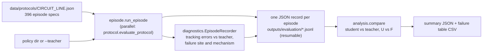

**Protocols** (`evaluation/protocol.py`). Each circuit and racing line has a frozen file of 396 episodes in five blocks, from in-sample to fully held out:

| Block            | Episodes | Start                     | Friction mu                       | Setup seeds        |
| ---------------- | -------- | ------------------------- | --------------------------------- | ------------------ |
| `in_sample_gate` | 20       | original                  | 0.8, 0.9, 1.0, 1.1, 1.2           | 42–45              |
| `seed_only`      | 40       | original                  | on-grid                           | 100–107 (held out) |
| `mu_only`        | 16       | original                  | 0.85, 0.95, 1.05, 1.15 (off-grid) | 42–45              |
| `start_only`     | 64       | 8 held-out starts (h1–h8) | 0.8, 1.2                          | 42–45              |
| `held_out`       | 256      | 8 held-out starts         | off-grid                          | held out           |

A **reduced protocol** (`reduce_protocol`, `scripts/reduce_protocol.py` → `data/protocols/<circuit>_<line>_reduced.json`) keeps 40 of these episodes, all from held-out starts, so that several training seeds can be evaluated:

| Block        | Episodes | Rule                                                                                       |
| ------------ | -------- | ------------------------------------------------------------------------------------------ |
| `held_out`   | 32       | start h_i × the four off-grid mu, the j-th with setup seed 100 + (i − 1 + j) mod 8         |
| `start_only` | 8        | start h_i, mu 0.8 (i odd) or 1.2 (i even), setup seed 42 + (i − 1) mod 4                    |

Every start meets five frictions and every held-out setup seed is used four times. The episodes are copies of the full protocol's, so their identifiers and results are shared with it.

**Episode** (`evaluation/episode.py`). The controller is the policy or the teacher, in one of two conditions:

- **U** (unfiltered): the proposal is only clipped to the action box;
- **F** (filtered): the proposal goes through the safety filter.

The teacher is evaluated on every observation even when it does not drive: its target speed and action are the reference of the tracking diagnostics. An episode ends at a completed lap, a termination event, a stall (non-Monza: less than 10 m in 2000 steps) or the step limit. A student policy drives on its student observation while the teacher and the diagnostics read the privileged one; the record also holds the policy's `student_level` and the episode's `traction_cost_sum`. For a student with the `mu` oracle entry, `oracle_offset`, `oracle_clip` and `mu_estimator` record the error added to the entry, its clip and the friction estimator that fills it, and `oracle_mu` summarises the ratio of the entry to the true `mu` (initial, final, mean, min, max, fraction above 1.06, time to reach 0.95). A plan coach drives with its executor policy; `plan_scale` summarises the scale of the `v_ref` preview over the steps (mean, min, max; constant for `--plan-scale`), `plan_decisions` lists the coach's decisions as `[s, c]`, and `plan_coach` names it.

| Outcome              | Definition                                                                    |
| -------------------- | ----------------------------------------------------------------------------- |
| `completed`          | wrap-corrected progress ≥ lap length                                          |
| `robust`             | completed, with no termination event and no empty-safe-set step               |
| `termination_reason` | first of: completed, filter exception, environment event, stalled, step limit |
| `lap_time_s`         | steps × 0.01 s, for completed laps                                            |

**Analysis** (`evaluation/analysis.py`). Rules fixed before the final evaluation:

- rates come with Wilson 95 % intervals;
- filter dependence pairs the U and F twins of each episode (exact McNemar test) and classifies the controller as FILTER-DEPENDENT, POLICY-DOMINATED or FILTER-ASSISTED;
- lap times are compared only on episodes robust for both controllers;
- each failure gets a mechanism: stall/low speed, track excursion, overspeed into slip (`vx > 1.05 v_target`), or slip without overspeed.

Several training seeds of one configuration are summarised by `seed_summary` (`scripts/analyze_seeds.py`). Per seed it reports the robust rate with its Wilson interval, the paired lap time against the teacher and the failure mechanisms. Across seeds it reports the mean, sample standard deviation, minimum and maximum of the robust rates, the pooled rate, and the episodes robust in every seed and in none.

---

## Models

| Directory                                            | Trained on                        | Use                                        |
| ---------------------------------------------------- | --------------------------------- | ------------------------------------------ |
| `models/all4`                                        | Monza, Spa, Catalunya, Budapest   | final multi-circuit policy                 |
| `models/loco_spa`, `loco_catalunya`, `loco_budapest` | all circuits except the named one | zero-shot transfer (leave-one-circuit-out) |
| `models/treatment_a`                                 | Monza only                        | single-circuit policy                      |
| `models/ppo_pilot_all4_monza`                        | ALL4 + 200k PPO steps on Monza R1 | paused pilot; no pace gain                 |

Every policy is the deterministic actor mean of an MLP (116-512-512-2, tanh) after a frozen `VecNormalize` of the observation (section 7).

## Reproducing the pipeline

Every stage is a script; outputs go to `outputs/` unless stated.

```bash
python scripts/prepare_tracks.py --circuit spa                         # rebuild data/tracks/spa (speed probe ~1 h)
python scripts/generate_demos.py --circuit spa --kind speed            # 20 perturbed laps -> outputs/demos/spa/speed
python scripts/generate_demos.py --circuit spa --kind lateral
python scripts/build_dataset.py --name all4                            # -> datasets/all4.npz
python scripts/generate_demos.py --circuit monza --kind speed --keep-failed --speed-safety 1.4   # -> speed_k1.40
python scripts/build_dataset.py --name treatment_a --mdp --kinds speed lateral speed_k1.40 --include-failed
python scripts/train_bc.py --dataset datasets/all4.npz --output outputs/models/all4
python scripts/evaluate.py --protocol data/protocols/spa_R1.json --model models/all4 --condition U --workers 8
python scripts/evaluate.py --protocol data/protocols/spa_R1.json --teacher --condition U --workers 8
python scripts/analyze.py --student outputs/evaluation/all4_spa_R1 --teacher outputs/evaluation/teacher_spa_R1 \
                          --output outputs/analysis/all4_spa_R1
python scripts/make_figures.py                                         # results/figures from results/final_results.json
python scripts/run_dagger.py --model models/treatment_a --output outputs/dagger           # paused
python scripts/finetune_ppo.py --model models/all4 --output outputs/ppo_all4_monza        # paused
python scripts/reduce_protocol.py --protocol data/protocols/monza_R0.json                 # -> monza_R0_reduced.json
python scripts/train_bc.py --dataset datasets/treatment_a_mdp.npz --output outputs/models/phase2/S2_label_s0 \
                           --level S2 --target label --seed 0 --skip-gate                 # one student, one seed
python scripts/train_bc.py --dataset datasets/treatment_a_mdp.npz --output outputs/models/phase2/S1_label_h50_s0 \
                           --level S1 --stride 50 --seed 0 --skip-gate                   # 3.5 s history
python scripts/train_bc.py --dataset datasets/treatment_a_mdp.npz --output outputs/models/phase2/S1_label_mu_s0 \
                           --level S1 --oracle mu --seed 0 --skip-gate                   # diagnostic: true mu
python scripts/evaluate.py --protocol data/protocols/monza_R0_reduced.json --model outputs/models/phase2/S2_label_mu_s0 \
                           --condition U --oracle-offset mu=-0.05 --workers 8            # mu known with error -0.05
python scripts/generate_demos.py --circuit monza --kind none --speed-safety 1.0          # slower teacher laps
python scripts/build_dataset.py --name treatment_a --mdp --kinds speed lateral none none_k1.00 none_k1.10 \
                                --out datasets/friction_monza_mdp.npz
python scripts/train_friction.py --dataset datasets/friction_monza_mdp.npz --output outputs/estimators/friction_s0
python scripts/evaluate.py --protocol data/protocols/monza_R0_reduced.json --model outputs/models/phase2/S2_label_mu_s0 \
                           --condition U --mu-estimator outputs/estimators/friction_s0 --workers 8   # S2 + mu_hat
python scripts/collect_closed_loop.py --policy outputs/models/phase2/S2_label_mu_s0 --estimator outputs/estimators/friction_s0 \
                                      --output datasets/friction_closed_loop_monza.npz --workers 8  # closed-loop laps
python scripts/train_friction.py --dataset datasets/friction_monza_mdp.npz datasets/friction_closed_loop_monza.npz \
                                 --output outputs/estimators/friction_cl_s0                      # estimator, both data
python scripts/train_offline_rl.py --dataset datasets/treatment_a_mdp.npz --algorithm iql \
                                   --output outputs/models/phase3/S2_iql_mu_s0 --seed 0          # offline RL (or td3bc)
python scripts/generate_demos.py --circuit monza --kind none --exec-speed-safety 1.4 --keep-failed   # -> none_x1.40
python scripts/generate_demos.py --circuit monza --kind speed_wide --keep-failed                    # wide perturbations
python scripts/analyze_seeds.py --teacher <teacher.jsonl> --group S2_label <seed files...> --output <summary.json>
python scripts/build_dataset.py --name all4 --mdp --kinds speed lateral speed_wide --include-failed --max-failed 2 \
                                --out datasets/recipe_all4_mdp.npz                             # the recipe, four circuits
python scripts/train_offline_rl.py --dataset datasets/recipe_all4_mdp.npz --algorithm td3bc \
                                   --output outputs/models/multi/S2_td3bc_mu_all4_s0 --seed 0
python scripts/collect_closed_loop.py --policy outputs/models/multi/S2_td3bc_mu_all4_s0 \
                                      --estimator outputs/estimators/friction_all4_s0 --workers 8 \
                                      --racing-line data/tracks/spa/racing_line_R1.npz \
                                      --output datasets/friction_all4_closed_loop_spa.npz      # estimator data, Spa
python scripts/evaluate.py --protocol data/protocols/spa_R1_reduced.json --model outputs/models/multi/S2_td3bc_mu_all4_s0 \
                           --condition U --oracle-offset mu=+0.05 --oracle-clip --workers 8     # an estimator's error
python scripts/train_coach.py --dataset datasets/recipe_monza_mdp.npz --init-policy outputs/models/planless/C_td3bc_s0 \
                              --output outputs/models/coach/C_monza_s0 --seed 0                  # coach, online RL
python scripts/train_plan_coach.py --executor outputs/models/multi/S2_td3bc_mu_all4_s0 \
                                   --output outputs/models/plan_coach/P_monza_s0 --seed 0        # plan coach
python scripts/evaluate.py --protocol data/protocols/monza_R0_reduced.json --model outputs/models/multi/S2_td3bc_mu_all4_s0 \
                           --plan-scale 1.08 --condition U --workers 8                           # constant plan scale
python scripts/analyze_independence.py --protocol data/protocols/monza_R0_reduced.json \
    --agent copy=outputs/models/multi/S2_td3bc_mu_all4_s0 --agent coach=outputs/models/plan_coach/P_monza_s1 \
    --output outputs/analysis/independence_monza_R0_reduced.json --workers 8                     # does it copy the teacher?
```

Demonstrations are always generated on the R0 lines. A full lap takes 10-30 s of CPU time, so one protocol (396 episodes) takes roughly 10-30 minutes with 8 workers.

## Figures of this README

The figures in `docs/figures/` are computed from the stored data and the package code (plant, teacher, filter, demonstration generator, policies), not drawn by hand, except the vehicle schematic:

```bash
python scripts/make_readme_figures.py                     # all figures (~1 min)
python scripts/make_readme_figures.py --only teacher safety_filter
```

## Tests

The tests check that this code reproduces outputs recorded from the original implementation, as follows.

**Bit-for-bit:**

- plant, environment, observation and reward trajectories on seven racing lines;
- unfiltered and filtered evaluation episodes of all five policies and of the teacher, including the safe-set mask of every step;
- failure diagnostics;
- the demonstration-lap specifications and perturbed laps on all four circuits;
- behaviour-cloning initialisation, trained weights and normaliser;
- the column moments and the standardisation by chunks (`learning/statistics.py`) against numpy's whole-array computation;
- the gate;
- one complete weighted-DAgger iteration;
- every stored track file from its predecessor;
- the transitions logged for the offline datasets, replayed in the environment (next observation, reward, traction cost, accelerometer channels), and the rows of the next states (`next_index`);
- the student observations built offline from the logged channels against those of the student environment, and the oracle entry of a diagnostic student with an offset and with its clip to the range of an estimate;
- a student policy trained on an offline dataset, its `student.json` and an evaluation episode on its observation;
- every stored reduced protocol against the reduction rule applied to its full protocol;
- the friction estimator: Kalman fusion and lower bound, calibrated margin and its floor, rise limit, training on short laps, no privileged input, online estimate equal to the offline one (with and without the rise limit), an evaluation episode driven on the estimate, and closed-loop laps logged with their circuit and added to its training data, with the validation per kind of lap and per circuit;
- offline RL: IQL and TD3+BC trained on a small offline dataset, the files of the policy directory, the actor's student layout, an evaluation episode driven by the actor, the critic diagnostic, the failure ablation (`strip_failures` against `compute_reward`), and the traction-cost constraint (multiplier range, saved cost networks, refusal for IQL or a negative budget);
- the track boundaries: a positive `e_y` (left) is bounded by the left edge, in the termination rule and in the safety filter, checked against the centreline reference;
- the coach: the observation of level `C` (offline and online, without the plan), the decision windows of the prior data, the friction it reads when exploring, the falling teacher prefix of its episodes, a short online training whose coach evaluates like a student, and a coach started from an offline policy (critic pretraining and online warm-up with the actor fixed, fixed λ, trust term, falling BC weight);
- independence from the teacher: speed profiles on a progress grid and their shape against the scaled teacher profile (no residual for a scaled copy), sector times, failure sites across the end of the lap, the measures of a scaled copy and a recorded trace;
- the plan coach: the plan scale of the student previews and of the student environment (constant, or changed during an episode), the levels that reject it, the actor that starts at the teacher's plan, a short online training and the evaluation of the coach with its executor and of a constant scale;
- the offline-data generators: an execution teacher with the certified speed factor reproduces the clean lap, a faster one drives faster under the certified labels, a noiseless lap gets one attempt, the cap on the failed attempts of a lap, and wide perturbations with their own noise.

**Within 1e-4 m:** the least-squares racing line.

**Exactly:** the analysis statistics.

Each training dataset was also checked once to be reproduced exactly from the kept demonstration laps.

```bash
pytest -m "not slow"     # fast subset
pytest                   # everything; tests marked `datasets` are skipped when datasets/ is absent
```

The reference environment is Python 3.14, NumPy 2, PyTorch 2.11, Stable-Baselines3 2.8 and Gymnasium 1.2, on CPU with one thread.
