# Ten-Tenths — model-free RL at the limit of grip

**Pure model-free reinforcement learning at the limit of grip.** A simulated GT4-class race car on the Circuit de Barcelona-Catalunya — a single-track Pacejka plant with combined slip, inertial load transfer, aerodynamic drag and a power limit — and PPO policies that learn to lap it as fast as the car allows, only from interaction with the simulator.

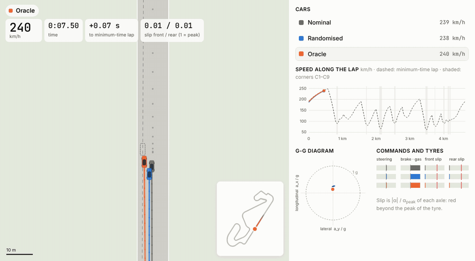

*The Nominal policy at the limit (seed 12) on a flying lap at b = 0, in a chase view drawn to scale: the dashed box is the ghost of the minimum-time lap, the grey dots are the track preview the policy observes. On the right, speed and time gap against the minimum-time lap, the g-g diagram, the commands and the slip of each axle over its peak. The flying lap takes 132.64 s, +3.8 % from the 127.83 s minimum-time lap (shown at 3× real time).*

There is no shield, no behaviour cloning, no reference line and no demonstration from a model-based controller: the policy sees the car's state and a preview of the track, and is rewarded for progress. Tyre saturation is measured, never imposed. A minimum-time lap of the same plant, solved as an optimal-control problem, is used **only to measure** how far the policies are from the limit; no policy ever sees it.

The project then asks how such a policy copes with **cars that handle differently**. The vehicle family varies in one scalar, the balance index `b`, which moves lateral grip between the front and the rear axle at a constant total: from understeering cars (`b < 0`) to oversteering ones (`b > 0`). Three policies are compared: a **Nominal** policy trained on `b = 0`, a **Randomised** one trained on a range of `b` without observing it, and an **Oracle** that also observes `b`.

### Results at a glance

- **PPO from random weights drives at the limit.** Five seeds of the Nominal policy, trained 600 M decisions on the free stage, complete 49 of 50 protocol laps from standing starts at a mean **+4.51 %** [3.84, 5.21] from the minimum-time lap from the same start; the best flying lap is +3.8 %. Continued training brings it to about +3.0–3.6 % per seed. The remaining gap has the same pattern on every seed: narrower lines that leave the outside of the corners unused, corners 1–2 m/s slower, and an understeering use of the tyres. A minimum-time lap confined to the width the policy uses accounts for a median 88 % of the gap.
- **At the limit `b` matters on every corner.** The Nominal policy only drives cars within about ±0.03 of its own balance. Randomised and Oracle policies drive **every car of their training range, held-out values included (50/50 laps), at 3.5–5 % from each car's own minimum-time lap**.
- **Randomisation costs lap time, not reliability:** +0.3 %, +0.6 % and +1.3 % at `b = 0` for the three widths of the range.
- **Knowing `b` changes how the car is driven, but gains little time inside the range.** The Oracle adapts its corner entry and apex speed to `b` like the minimum-time lap does; the net regret of the Randomised policy is at most +0.24 s, below the 0.5 s fixed in advance, so **a policy with memory is not needed** here. The Oracle's real advantage is outside the range, on more oversteering cars.

## Contents

- [Quick start](#quick-start)
- [Repository layout](#repository-layout)
- [1. Vehicle plant](#1-vehicle-plant--model)
- [2. Tracks](#2-tracks--modeltrackpy-tracks)
- [3. Environment](#3-environment--env)
- [4. The learning problem: state, observation, action, reward](#4-the-learning-problem-state-observation-action-reward)
- [5. Training](#5-training--learning)
- [6. Evaluation](#6-evaluation--evaluation-reference)
- [7. Results](#7-results)
- [Figures, animations and lap viewer](#figures-animations-and-lap-viewer--scriptsfigures)
- [Tests](#tests)

## Quick start

```bash
python -m venv .venv && source .venv/bin/activate
pip install -e ".[dev]"            # add the "reference" extra (CasADi) for the minimum-time lap
pytest                             # plant, balance index, environment, tracks, learning and evaluation (seconds)
```

Models, training logs, evaluations, recorded laps and figures are written to `outputs/`, which is not tracked.

## Repository layout

```
src/contextual_bicycle_pacejka/
    spec/        constants and the layouts of the state, setup, observation and action vectors
    model/       vehicle plant, tyres, load transfer, powertrain, track, point-mass profile, steady-state handling,
                 observation, failures, reward
    env/         Gymnasium environment at 20 Hz, its factory and vectorised form, speed stages, setup sampling
    tracks/      centreline reference of a circuit from the TUM racetrack database
    learning/    PPO configuration, training curves and the automatic speed curriculum
    reference/   minimum-time lap reference (evaluation only)
    evaluation/  protocol laps, stage criterion, corners, distance from the limit, evaluation over b, action noise,
                 result statistics and the check of the balance index
data/tracks/     the Catalunya circuit: TUM centreline CSV and its reference (curvature and track widths)
docs/figures/    figures and animations of this README
research/        literature corpus metadata (the papers and third-party code are not tracked)
scripts/         command-line entry points (training, evaluation, minimum-time lap, analysis, throughput)
scripts/figures/ recorded laps, static figures, animations and the interactive lap viewer of the results
tests/           plant and environment rollouts, balance index, track preparation, minimum-time lap, learning and
                 evaluation, against recorded golden data
```

---

## 1. Vehicle plant — `model/`

The car is a **single-track (bicycle) model** written in the **Frenet frame** of the circuit's centreline: the car is described by how far along the centreline it is (`s`), how far to its side (`e_y`) and how its heading differs from the centreline's (`e_psi`). The plant is pure NumPy/SciPy with no Gymnasium dependency, and every quantity is float64.


| File                     | Content                                                                                                                                       |
| ------------------------ | --------------------------------------------------------------------------------------------------------------------------------------------- |
| `model/state.py`         | `VehicleState` (7 states), `VehicleMemory` (previous-step forces for load transfer), `SetupVector` (5 setup parameters), `AdmissibilityError` |
| `model/actuator.py`      | first-order steering lag                                                                                                                      |
| `model/tires.py`         | slip angles, lateral capacity scales of the balance index, combined-slip capacity, Pacejka lateral force, peak slip angle `alpha_sat`         |
| `model/load_transfer.py` | longitudinal load transfer from the previous step                                                                                             |
| `model/powertrain.py`    | rear-wheel drive, power limit, brake bias, friction limit on the longitudinal forces, top-speed bound of a stage                              |
| `model/dynamics.py`      | `step_plant`: one 10 ms step in causal order                                                                                                  |
| `model/point_mass.py`    | point-mass speed profile and lap time of a circuit: a yardstick and the bound of the start speeds                                            |
| `model/handling.py`      | steady state: constant-radius trim, understeer gradient, lateral limit, yaw stability and critical speed                                      |
| `model/track.py`         | `RealTrack`: periodic-spline centreline with the track widths (see section 2)                                                                 |
| `model/observation.py`   | the observation of the racing policies (see section 4)                                                                                        |
| `model/termination.py`   | failures: off track, spin, stall                                                                                                              |
| `model/reward.py`        | reward of one decision: normalised progress, action rate, failure                                                                             |
| `spec/constants.py`      | every number of the model, with its unit                                                                                                      |

**Fixed vehicle data** (`spec/constants.py`): `l_f = 1.2 m`, `l_r = 1.4 m`, `I_z = 1800 kg m²`, `A_MAX = 8 m/s²`, `D_MAX = 12 m/s²`, front brake share `BETA_BRAKE = 0.65`, steering limit `DELTA_MAX = 0.5 rad`, integration step `DT = 0.01 s` (100 Hz, explicit Euler).

**Drag and power** of a GT4-class car, the Porsche 718 Cayman GT4 (EU technical data: 309 kW, `cd x A = 0.69 m²`, 304 km/h, 1420 kg): drag area `0.69 m²`, air density `1.2 kg/m³`, and a power at the wheels of 249 kW, the power that holds the published top speed against the drag (the plant has no rolling resistance or driveline losses). `PlantOptions` switches the inertial load transfer, the drag and the power limit; `ORIGINAL_PLANT` switches all three off and reproduces the original plant bit for bit (the original load transfer used `(Fx_r + Fx_f cos delta) / m + vy r`, which unloaded an axle in a slide).

### One plant step

`step_plant(state, action, setup, memory, track, dt)` advances the car by one step. The order is causal: the load transfer uses the forces of the **previous** step, so there is no algebraic loop.

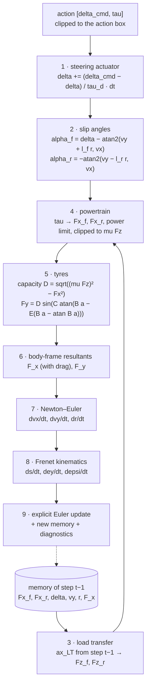

The equations, as implemented:

```
actuator      delta'   = clip(delta + (delta_cmd - delta) / tau_d * dt, ±0.5)
load transfer ax_LT    = F_x,prev / m        (= dvx/dt - vy r: the longitudinal acceleration of the centre of mass)
              Fz_f     = m / L (g l_r - ax_LT hcg),     Fz_r = m / L (g l_f + ax_LT hcg),     L = l_f + l_r
powertrain    tau >= 0: Fx_f = 0,                       Fx_r = tau min(m A_MAX, P / max(vx, 1 m/s))
              tau <  0: Fx_f = tau m D_MAX 0.65,        Fx_r = tau m D_MAX 0.35
              |Fx_i| <= mu Fz_i
drag          D      = 1/2 rho cdA vx^2, against vx, part of F_x
dynamics      dvx/dt = F_x / m + vy r,    dvy/dt = F_y / m - vx r,    dr/dt = (l_f (F_y - Fy_r) - l_r Fy_r) / I_z
Frenet        ds/dt  = (vx cos e_psi - vy sin e_psi) / (1 - kappa(s) e_y)
              de_y/dt = vx sin e_psi + vy cos e_psi,      de_psi/dt = r - kappa(s) ds/dt
```

The plant raises `AdmissibilityError` if an axle load becomes non-positive or if `1 − kappa e_y ≤ 0` (the Frenet frame becomes singular). The environment turns this into a clean termination.

### Tyres and the balance index

Each axle has a Pacejka "magic formula" lateral force. `C` and `E` are the identified AV-24 shape and curvature factors (Jardali et al.); `B` is calibrated so that the force peaks at about 0.12 rad (front) and 0.13 rad (rear). The peak `D` is the **combined-slip capacity**: the longitudinal force has priority, and the lateral force gets what is left of the friction circle `mu Fz`.

The **balance index** `b` moves lateral capacity between the axles at a constant static total: the lateral capacity of each axle is multiplied by `lambda_f = 1 + b` and `lambda_r = 1 − b LR / LF` (`compute_lateral_scales`), so that `lambda_f Fz_f0 + lambda_r Fz_r0 = Fz_f0 + Fz_r0`. A positive `b` moves grip to the front (oversteer), a negative one to the rear (understeer); `b = 0` is the original plant, bit for bit. The longitudinal limit stays `mu Fz` and `B, C, E` stay fixed, so the cornering stiffness scales with `lambda_i` and `alpha_sat` does not depend on `b`.


The peak slip angle `alpha_sat` (`compute_saturation_threshold`) depends only on `B, C, E`. The steady-state handling of the family (`model/handling.py`, checked by `scripts/check_balance_index.py`) shows what one scalar does to the car:

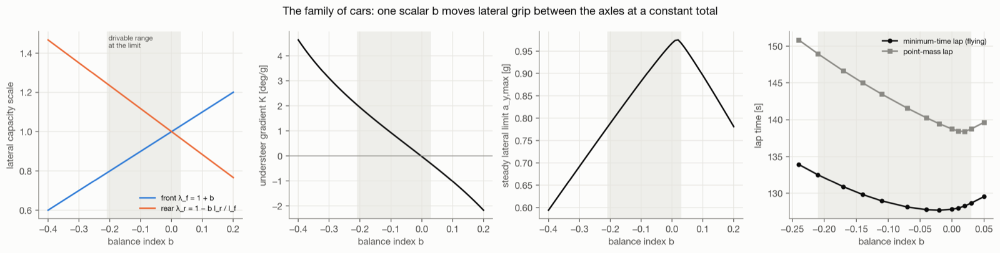

*From left to right: the capacity scales of the two axles; the understeer gradient, which crosses zero just above `b = 0`; the steady lateral limit, highest where the two axles saturate together; and the lap time of the minimum-time lap and of the point-mass lap for each `b`. The shaded band is the range drivable at the limit, [−0.21, +0.03]: above about +0.03 the car becomes unstable on the straights below its top speed, so the range is asymmetric. The fastest car is at `b ≈ −0.02`; at `b = −0.24` the minimum-time lap is 4.8 % slower.*

### Failures — `model/termination.py`

After every plant step the environment ends the episode on the first of:

| Failure        | Condition                                                                         |
| -------------- | --------------------------------------------------------------------------------- |
| `off_track`    | `e_y` beyond the edge distance on its side at `s` (left edge for `e_y > 0`)       |
| `spin`         | `\|e_psi\| > pi / 2`                                                              |
| `stall`        | `vx < 1.5 m/s`                                                                    |
| `inadmissible` | the plant raised `AdmissibilityError` (set by the environment)                    |

In training the edge is moved 0.3 m inwards (`TRAINING_EDGE_MARGIN_M`, `--edge-margin`), so that the policy keeps a small margin; evaluation uses the true edges. A completed lap does **not** end the episode.

---

## 2. Tracks — `model/track.py`, `tracks/`

`RealTrack(npz_path)` loads the centreline reference of a circuit and builds periodic cubic splines of every quantity, so every query wraps around the lap:

| NPZ key                       | Meaning                                                | Accessor                                                         |
| ----------------------------- | ------------------------------------------------------ | ---------------------------------------------------------------- |
| `s_m`, `track_length`         | arc length, lap length                                 | `track_length`                                                   |
| `x_m`, `y_m`                  | world coordinates of the centreline                    | `centerline_point(s)`                                            |
| `psi_rad`                     | heading (splined after removing the ±2π-per-lap trend) | `psi_ref(s)`                                                     |
| `kappa_radpm`                 | signed curvature                                       | `kappa(s)`                                                       |
| `w_tr_right_m`, `w_tr_left_m` | distances from the centreline to the track edges       | `boundary_right/left(s)`, `ey_max(s)`, `is_out_of_bounds(ey, s)` |

The edge distances are the circuit's own: the car leaves the track when its lateral offset exceeds them.

`tracks/reference.py` builds the reference from the TUM racetrack database CSV (`x, y, w_right, w_left`): it closes the centreline, centres it at the origin, and computes the arc length, the heading and a smoothed curvature (`data/tracks/<circuit>/tum_centerline.csv` → `reference.npz`).

| Circuit   | Centreline length (km) | Track width (m) | Tightest corner radius (m) |
| --------- | ---------------------- | --------------- | -------------------------- |
| Catalunya | 4.65                   | 8.6 – 17.8      | 22.8                       |

<p align="center">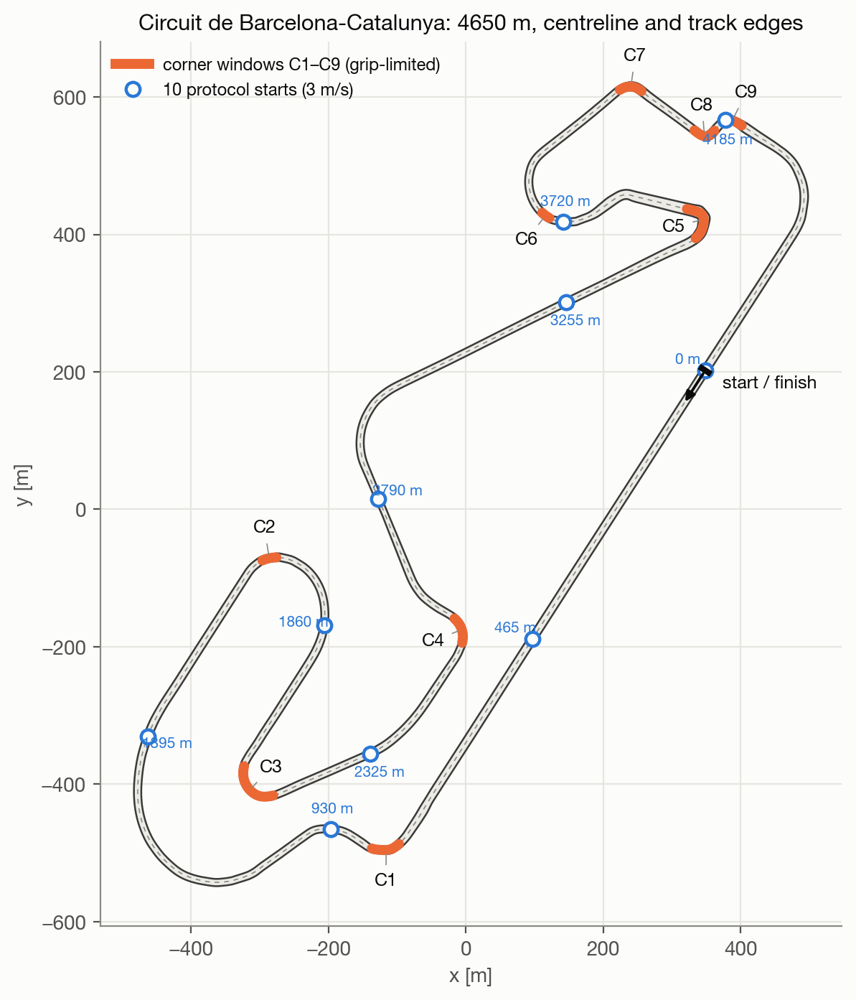</p>

*The circuit with the nine grip-limited corners C1–C9 on which the corner measurements are taken, and the 10 equally spaced starts of the evaluation protocol.*

---

## 3. Environment — `env/`

`RacingEnv` (`env/environment.py`) is a Gymnasium environment on one circuit and one **speed stage**; decisions are taken at **20 Hz** (every 5 plant steps). `make_env(reference, stage, b_range, oracle, edge_margin)` (`env/factory.py`) builds it and adds a `TimeLimit` of 1024 decisions (51.2 s); `make_vec_env(reference, n_envs, seed, ..., workers)` builds `n_envs` copies for PPO: with `workers > 0` they run in that many subprocesses, several per process (`BatchedSubprocVecEnv`, `env/vec_env.py`), with one message per process and decision; with `workers = 0` in this process. On a 10-core machine, 10 processes × 32 environments give about 43,000 decisions/s.

```python
from contextual_bicycle_pacejka.env import make_env
import numpy as np

env = make_env("data/tracks/catalunya/reference.npz", stage=7, b_range=(-0.21, 0.03), oracle=True)
obs, info = env.reset(seed=42, options={
    "initial_s": 400.8,      # optional: uniform on the lap
    "initial_vx": 20.0,      # optional: uniform between 3 m/s and 0.8 times the point-mass speed at initial_s
})
obs, reward, terminated, truncated, info = env.step(np.array([0.0, 0.5], dtype=np.float32))
```

**Reset.** Draws (or receives) the setup with its balance index, places the car on the centreline (`e_y = e_psi = vy = r = delta = 0`) at a random point of the lap and at a **feasible** random speed — uniform between 3 m/s and 0.8 times the point-mass speed profile at that point, so that the car can still take the corners ahead — zeroes the memory and the commands, and returns the first observation.

**Step.** The action `[a_1, a_2] ∈ [−1, 1]²` gives the steering reference `delta_ref = 0.5 a_1` rad and the rate `5 a_2` 1/s of the longitudinal command `tau`, integrated once per decision. The top-speed bound of the stage caps the integrated command, so that it does not wind up to full throttle while the speed is bounded. Then, for 5 plant steps: the traction fades out within 5 % of the top speed of the stage (`limit_top_speed`), `step_plant` advances the car, and the failures are checked; the decision stops at the first failure. A failure ends the episode with its penalty; the vectorised environment starts the next one at once, at a random point of the centreline, as in Czechmanowski et al. (IROS 2025). `info` holds the `failure` (or None), the `reward_terms`, the `progress` [m], the raw `state` and `setup`, the `laps` completed and the `slip_ratio`, the `|alpha| / alpha_sat` of each axle at the end of the decision.

### Speed stages — `env/stages.py`

The policy can learn at increasing top speeds: 5, 10, 20, 30, 40, 60 m/s (stages 1–6), then with no bound (stage 7, the **free stage**). The free stage is sized at 70 m/s: with the drag and the power of the car, a point-mass profile of Catalunya peaks at 68.8 m/s and laps in 138.7 s (`model/point_mass.py`). `make_stage(number, track)` sets every speed-dependent parameter from an explicit rule:

| Parameter        | Rule                                                                                              |
| ---------------- | ------------------------------------------------------------------------------------------------- |
| preview horizon  | braking distance `v² / (2 mu g)` plus one second, `v` the top speed                               |
| preview points   | 30, spaced quadratically (dense near the car), the first one decision ahead (`0.05 v`)            |
| scales           | speed `v`; yaw rate `min(v, sqrt(mu g R_min)) / R_min`; widths `w_max`; curvature `1 / R_min`     |
| start speeds     | at a point `s`: uniform between 3 m/s and `0.8 v_pm(s)`, the point-mass profile with the top speed |

`R_min` (22.8 m on Catalunya) is the radius of the tightest corner and `w_max` (9.3 m) the widest half-width. The progress reward is normalised by the top speed (by the sizing speed when there is none). `RacingEnv.set_top_speed(v)` changes the top speed during training (`env_method` on the vectorised environment): the start speeds and the reward normalisation follow, the observation does not, so a curriculum can raise the top speed of the free stage step by step (section 5).

### Setup sampling — `env/setup_sampling.py`

Every episode has its own setup `xi = [m, mu, hcg, tau_d, b]`. Only the balance index varies; the other entries stay at their nominal values:

| Entry   | Meaning                  | Value                                   |
| ------- | ------------------------ | --------------------------------------- |
| `m`     | mass                     | 1400 kg                                 |
| `mu`    | peak tyre-road friction  | 1.0                                     |
| `hcg`   | centre-of-gravity height | 0.50 m                                  |
| `tau_d` | steering lag             | 0.03 s                                  |
| `b`     | balance index            | uniform in `b_range` (default: `b = 0`) |

`sample_setup(rng, b_range, b_exclude)` draws a setup, drawing `b` again while it falls in one of the open bands `b_exclude` (`held_out_bands(centres)` gives bands of half-width 0.01 around held-out values of `b`).

---

## 4. The learning problem: state, observation, action, reward

Seen as a reinforcement-learning problem, the task is a **contextual MDP**: the context is the balance index `b` of the setup `xi`, sampled at reset and constant within the episode.

| Element     | Definition                                                           | Where                                     |
| ----------- | -------------------------------------------------------------------- | ----------------------------------------- |
| Plant state | `z = [s, e_y, e_psi, vx, vy, r, delta]` + one-step memory            | `model/state.py`                          |
| Context     | `xi = [m, mu, hcg, tau_d, b]`, `b` uniform per episode               | `env/setup_sampling.py`                   |
| Observation | 100 float32 entries (101 for the Oracle, with `b`), scaled per stage | `model/observation.py`, `spec/layout.py`  |
| Action      | `[delta_ref, tau rate] ∈ [−1, 1]²`, at 20 Hz                          | `spec/layout.py`                          |
| Transition  | 5 deterministic `step_plant` steps of 10 ms explicit Euler           | `model/dynamics.py`, `env/environment.py` |
| Reward      | normalised progress − action rate − failure penalty                  | `model/reward.py`                         |
| Termination | off track, spin, stall, inadmissibility                              | `model/termination.py`                    |
| Truncation  | `TimeLimit` (1024 decisions, 51.2 s)                                 | `env/factory.py`                          |

The dynamics are deterministic: all the randomness is in the setup and the start.

### State

The **plant state** `z` (float64) lives in the Frenet frame of the centreline:

| Index | Symbol  | Unit  | Meaning                                                             |
| ----- | ------- | ----- | ------------------------------------------------------------------- |
| 0     | `s`     | m     | arc length along the centreline (not wrapped: it grows across laps) |
| 1     | `e_y`   | m     | lateral distance from the line, positive to the left                |
| 2     | `e_psi` | rad   | heading of the car minus heading of the line                        |
| 3     | `vx`    | m/s   | longitudinal velocity in the body frame                             |
| 4     | `vy`    | m/s   | lateral velocity in the body frame                                  |
| 5     | `r`     | rad/s | yaw rate                                                            |
| 6     | `delta` | rad   | actual (post-actuator) steering angle                               |

The plant also keeps a **memory** of the previous step (`Fx_r, Fx_f, delta, vy, r`, and the longitudinal resultant `F_x`) for the load transfer. The controllers never see `s` directly or the memory: they see the observation.

### Observation (100 entries, 101 for the Oracle)

The observation is assembled by `build_observation` after every decision. Its layout is fixed in `spec/layout.py` (`OBS.*` indices); every entry is divided by a scale of the speed stage:

| Index | Content                                                                  | Scale                       |
| ----- | ------------------------------------------------------------------------ | --------------------------- |
| 0–1   | `vx, vy`                                                                 | top speed                   |
| 2     | yaw rate `r`                                                             | yaw-rate scale of the stage |
| 3–4   | `e_psi, e_y` (to the centreline)                                         | pi / 2, `w_max`             |
| 5–6   | steering angle `delta`, previous reference `delta_ref`                   | 0.5 rad                     |
| 7–8   | longitudinal command `tau`, its previous rate                            | 1, 5 1/s                    |
| 9     | friction `mu`                                                            | 1                           |
| 10–39 | mean curvature over the 30 preview intervals (integral of the curvature) | `1 / R_min`                 |
| 40–69 | left half-width at the 30 preview points                                 | `w_max`                     |
| 70–99 | right half-width at the 30 preview points                                | `w_max`                     |
| 100   | balance index `b` (**Oracle only**)                                      | 0.2                         |

Nominal and Randomised policies read no hidden parameter of the car; the Oracle reads `b`. No entry carries a racing line or a target speed: where to drive and how fast is left entirely to the policy.

### Action

| Index | Symbol      | Range   | Meaning                                                                                                                |
| ----- | ----------- | ------- | ---------------------------------------------------------------------------------------------------------------------- |
| 0     | `delta_ref` | [−1, 1] | steering reference `0.5 a_1` rad; the actual angle follows with lag `tau_d`                                            |
| 1     | `tau rate`  | [−1, 1] | rate `5 a_2` 1/s of `tau`; `tau ≥ 0`: throttle, rear force `tau m A_MAX`; `tau < 0`: brake, `tau m D_MAX` split 65/35 |

### Reward — `model/reward.py`

```
r_k = ds_k / (v · 0.05 s)                                        progress along the centreline, at most about 1
    − 0.01 · [(Δdelta_ref / 1 rad)² + (tau rate / 5 1/s)²]       change of the actions
    − 1 · 1[failure]
```

`v` is the top speed of the stage, so the failure penalty keeps the same weight at every stage. The learner receives `0.1 r_k`: discounted returns of about 10, close to those of progress in metres in Czechmanowski et al., which keeps the value loss small without changing the optimum. The progress reward follows Czechmanowski et al. (IROS 2025, equation 3). Progress is measured along the centreline, so the reward itself pays for a shorter line through the corners: nothing tells the policy where the tyres peak.

---

## 5. Training — `learning/`

PPO of Stable-Baselines3 is configured as in Czechmanowski et al. (IROS 2025) (`learning/ppo.py`):

| Setting               | Value                                                                                  |
| --------------------- | -------------------------------------------------------------------------------------- |
| actor, critic         | separate MLPs, 256 × 2 and 512 × 2, LeakyReLU (slope 0.2)                              |
| environments, rollout | 320 (10 processes × 32), 1024 decisions each                                           |
| discount              | 0.99 per decision (about 5 s); 0.995 at the limit (`--gamma`, about 10 s)              |
| learning rate         | linear over each stage, 1e-3 to 1e-4 from random weights; 3e-4 to 3e-5 from trained weights |
| minibatch, epochs     | 1024, 5, with a target KL divergence of 0.02                                           |
| other settings        | Stable-Baselines3 defaults                                                             |

Training runs at about 22,000 decisions/s on a 10-core machine, update included. A stage can start from the weights of another model (`--init`): actor, critic and log-std are copied, the optimiser starts afresh.

**Through the speed stages.** The first study trains through the stages in order, each stage starting from the weights of the previous one, for 20 M decisions per stage at 5 and 10 m/s and 60 M decisions per stage from 20 m/s. From 20 m/s the learning rate runs from 3e-4 to 3e-5 (`--lr-start`, `--lr-end`), so that a policy that already drives does not drift away.

```bash
python scripts/train_curriculum.py --seed 0 --stages 1 --budget 20000000
python scripts/train_curriculum.py --seed 0 --stages 2 --budget 20000000 --init outputs/models/nominal/s0/stage1.zip
python scripts/train_curriculum.py --seed 0 --stages 3 --budget 60000000 --init outputs/models/nominal/s0/stage2.zip \
    --lr-start 3e-4 --lr-end 3e-5
python scripts/evaluate_stage.py --stage 1 --seeds 0 1 2 3 4
```

**At the limit.** The policy at the limit trains directly on the free stage (stage 7), from random weights, with `gamma = 0.995` and 600 M decisions per seed. The feasible random starts and the failures already act as a curriculum: a pilot of two seeds per approach found that this beats an automatic speed curriculum (`learning/curriculum.py`, `--curriculum`: the top speed starts at 10 m/s and rises by 2.5 m/s whenever the training failures fall below 0.2 per equivalent lap), which never reached the free stage in the same budget. `--checkpoint N` saves a copy of the model at N decisions.

```bash
python scripts/train_curriculum.py --seed 10 --stages 7 --budget 600000000 --gamma 0.995 --checkpoint 300000000 --tag nominal_limit
```

**Randomised and Oracle.** The same recipe trains on a range of `b` (`--b-range lo hi`), drawn at every reset outside the bands around held-out values (`--b-held-out`); the Oracle also reads `b` (`--oracle`). Both start from the weights of a Nominal policy: the Oracle's first layers get a zero column for `b`, so it starts exactly as the Nominal policy (`learning/ppo.py`, `widen_inputs`). At the limit, every configuration continues from the Nominal at the limit for 150 M decisions with the learning rate from 3e-4 to 3e-5; so does a **continued Nominal** at `b = 0`, which gives the paired baseline at the same total training.

```bash
python scripts/train_curriculum.py --seed 10 --stages 7 --budget 150000000 --gamma 0.995 \
    --init outputs/models/nominal_limit/s10/stage7.zip --lr-start 3e-4 --lr-end 3e-5 \
    --b-range -0.21 0.03 --b-held-out -0.11 --oracle --tag oracle_limit_w1
```

`learning/monitor.py` writes one line per rollout to `outputs/logs/<tag>/s<seed>_stage<k>.jsonl`: progress per decision, failures per type every 1000 decisions, laps, the share of decisions with each axle beyond its peak slip, decisions/s and the PPO losses.

---

## 6. Evaluation — `evaluation/`, `reference/`

**Protocol laps** (`evaluation/laps.py`, `evaluation/stage_gate.py`): from 10 starts equally spaced along the lap, at 3 m/s, the deterministic policy (the mean action) drives one lap or fails; a lap slower than four times the lap at top speed fails as a timeout. A seed passes when it completes at least 9 of its 10 laps, and a stage passes when at least 4 of 5 seeds pass. The completion rate over seeds × starts is reported with a 95 % interval from a two-level bootstrap that resamples seeds and starts independently. On the bounded stages, lap times are compared with a point-mass lap at the top speed of the stage, a yardstick that no policy uses. `evaluate_stage.py --b` drives the protocol laps with a car of balance index `b`, and recognises an Oracle model from the size of its observation.

**Minimum-time reference** (`reference/min_time.py`, `scripts/min_time_lap.py`; needs `casadi`, the `reference` extra). The fastest lap of the plant car on Catalunya, with a free line inside the edges, solved as an optimal-control problem along the centreline with CasADi and IPOPT: the plant's equations (checked against the plant to 1e-9 in `tests/test_min_time.py`), the slip of each axle bounded by its peak, and the steering lag left out (so the reference is at most slightly optimistic). With the GT4 drag and power it laps in **127.83 s** at `b = 0`, 8 % faster than the point-mass lap on the centreline, with both axles at their peak slip in every grip-limited corner. It only measures policies, as `(T - T_opt) / T_opt` and corner by corner; no policy sees it.

<p align="center">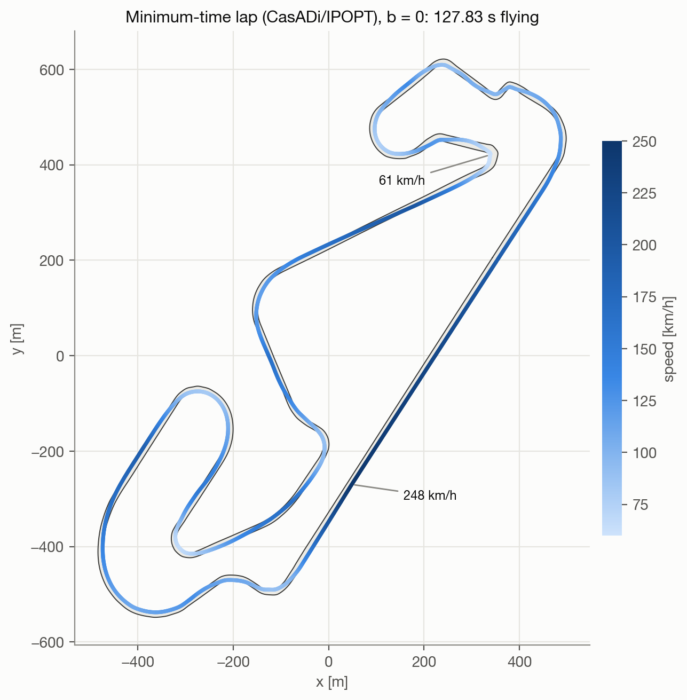</p>

```bash
python scripts/min_time_lap.py --b 0 --ds 2 --standing-starts
```

**Distance from the limit** (`evaluation/limit.py`, `evaluation/corners.py`, `scripts/compare_with_reference.py`). A protocol lap starts from rest, so it is compared with the minimum-time lap from the same standing start, `T_opt(s_i)` (129.0–134.0 s on Catalunya): its distance from the limit is `(T - T_opt(s_i)) / T_opt(s_i)`. A seed is **at the limit** when it completes at least 9 of 10 laps with a median distance of at most 5 %, a policy when 4 of 5 seeds are. The comparison also sets the policy's corner measurements (speeds, braking point, lateral offset at the apex, slip peaks and time near and beyond the peak) against the reference corner by corner. `evaluate_balance.py --model` evaluates a saved checkpoint.

```bash
python scripts/evaluate_balance.py --tag nominal_limit --stage 7 --grid 0 --seeds 10 11 12 13 14 --name nominal_limit
python scripts/compare_with_reference.py --evaluation outputs/evaluation/balance/nominal_limit.json
```

**Evaluation over b** (`evaluation/balance_study.py`, `evaluation/corners.py`). `scripts/evaluate_balance.py --tag <tag>` drives the protocol laps of every seed at each of 13 values of `b`, with the mean action and with three seeded repeats of the stochastic policy, and records for each of the 9 grip-limited corners the entry, minimum and exit speed, the braking point, the peak steering and the peak front and rear slip over the peak slip. For each width of the training range a value of `b` is nominal, interpolation, held-out or extrapolation. `scripts/summarise_balance.py` compares the policies paired by seed and start (the models of one seed start from the same weights): the cost of randomisation (Randomised − Nominal), the completion and lap time per class of `b`, and the regret R(b) = T_Randomised(b) − T_Oracle(b); lap times are also divided by the point-mass lap with the cornering limit of that `b` (`point_mass_lap_time(..., lateral_ratio)`).

Two studies are defined (`BalanceDesign` in `evaluation/balance_study.py`): `stage3`, at 20 m/s, and `limit`, on the free stage, with the grid b ∈ {−0.24 … +0.05} and the widths W1/3 [−0.07, +0.01], W2/3 [−0.14, +0.02], W1 [−0.21, +0.03] of the drivable interval at 70 m/s. `summarise_balance.py --design limit` also reports the distance from the limit of every policy and `b` against the minimum-time laps of that `b`, the slope against `b` of the entry and minimum speed in the slowest corner (does the policy adapt like the minimum-time lap?), and the gap between Oracle and Randomised **net** of the gap they already show at `b = 0` (`net_difference`). A width calls for a policy with memory when, over its interpolation and held-out values, the net completion difference is at least 0.10 or the net regret at least 0.5 s, with the 95 % interval above 0. This rule was fixed before the evaluation.

```bash
python scripts/min_time_lap.py --b -0.24 -0.21 -0.17 -0.14 -0.11 -0.07 -0.04 -0.02 0 0.01 0.02 0.03 0.05 --standing-starts
python scripts/evaluate_balance.py --tag randomised_limit_w1 --stage 7 --seeds 10 11 12 13 14 \
    --grid -0.24 -0.21 -0.17 -0.14 -0.11 -0.07 -0.04 -0.02 0 0.01 0.02 0.03 0.05
python scripts/summarise_balance.py --design limit
```

**Mean action and action noise** (`evaluation/action_noise.py`, `scripts/diagnose_mean_action.py`). The protocol laps drive the mean action of the Gaussian policy, training drives samples. The diagnosis drives the protocol laps with clip(mu + k sigma eps) for noise scales k from 0 (the mean action) through 1 (the noise of training) to 2, and records at every decision the mean action, its standard deviation and the bias E[clip(mu + sigma eps)] − clip(mu) that clipping puts between the commands of training and the mean action (closed form, `clipped_gaussian_mean`). Each lap is compared with the minimum-time lap from the same start; the wall and CPU time of every run are saved with the laps.

```bash
python scripts/diagnose_mean_action.py
```

**Use of the track width** (`scripts/edge_usage.py`). `min_time_lap.py --edge-margin d ...` solves the flying minimum-time lap with both edges moved d inside the track's own (`corridor`), which gives the cost of a narrower line. `edge_usage.py` reads the recorded flying laps and measures how far each policy stays from the edge where the minimum-time lap touches it, at the apex (inside edge) and at corner entry and exit (outside edge). It then gives the share of the policy's gap that a lap as narrow as the policy's explains, (T(d) − T(0)) / (T_policy − T(0)).

```bash
python scripts/min_time_lap.py --edge-margin 0.3 0.6 1 1.5 2 2.5 3 3.5
python scripts/figures/record_laps.py --only flying --workers 8
python scripts/edge_usage.py
```

---

## 7. Results

All numbers below use the protocol of section 6: 5 seeds × 10 standing starts, the mean action, intervals at 95 %. The criteria were fixed before each run and not changed after it.

### 7.1 Through the speed stages, nominal car

PPO from interaction only drives the nominal car (`b = 0`, original plant) on Catalunya up to 20 m/s:

| Stage      | Seeds passing       | Laps  | Mean lap time (s) | Point-mass lap (s) |
| ---------- | ------------------- | ----- | ----------------- | ------------------ |
| 1 (5 m/s)  | 5 of 5              | 50/50 | 922.3             | 930.0              |
| 2 (10 m/s) | 4 of 5              | 40/50 | 460.0             | 465.0              |
| 3 (20 m/s) | 3 of 5 (not passed) | 30/50 | 230.5             | 233.8              |

Stage 3 is the first with grip-limited corners; it stopped at 3 of 5 seeds with two learning rates, each after two budgets of 60 M decisions. The seeds that drive beat the point-mass lap by cutting the corners, since progress is measured along the centreline. At 20 m/s, Randomised and Oracle policies widen the range of `b` that is driven at a small cost, but only about 4 % of the lap is grip-limited, so `b` changes little. This is why the study moved to the limit, with a plant that has drag and a power limit, and to training directly on the free stage.

### 7.2 The Nominal policy at the limit

Five seeds trained from random weights for 600 M decisions on the free stage:

| Seed  | Laps  | Median distance from the minimum-time lap |
| ----- | ----- | ----------------------------------------- |
| 10    | 10/10 | +5.18 %                                   |
| 11    | 10/10 | +3.83 %                                   |
| 12    | 10/10 | +3.62 %                                   |
| 13    | 9/10  | +4.11 %                                   |
| 14    | 10/10 | +5.56 %                                   |
| Total | 49/50 | mean +4.51 % [3.84, 5.21]                 |

Three of five seeds are within 5 %, so the criterion (four) is narrowly missed: the threshold falls inside the seed-to-seed spread of about 2 points. The policies learn the limit gradually: the mean training speed keeps rising for the whole budget, failures fall by two orders of magnitude, and the share of decisions with the front axle beyond its peak slip falls from 75 % to about 10 %, while the rear is used more and more.

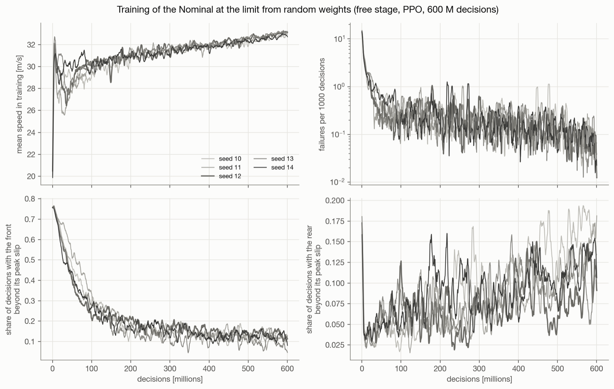

Against the minimum-time lap, the policy brakes at nearly the same points (within 7 m) and follows the same speed profile, but loses time steadily in the corners: it uses 67–80 % of the optimal apex offset from the centreline and passes the corners 1.1–1.8 m/s slower. The time gap grows by small steps at every corner rather than in one place.

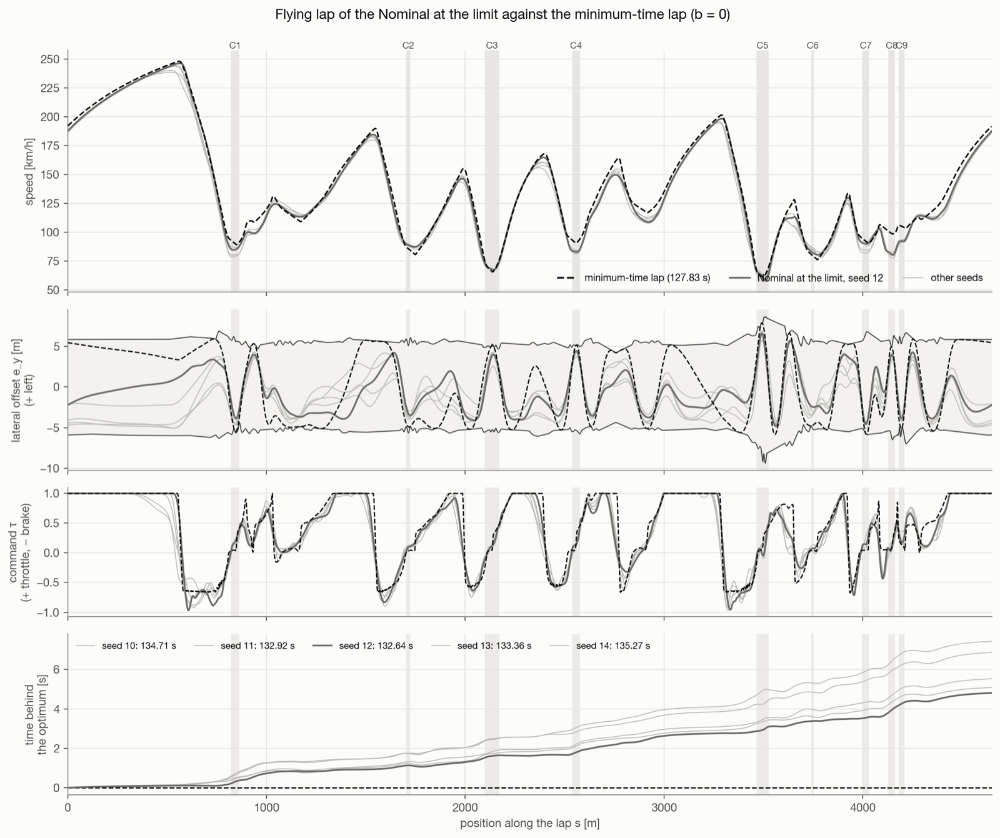

<table>
<tr>
<td width="50%">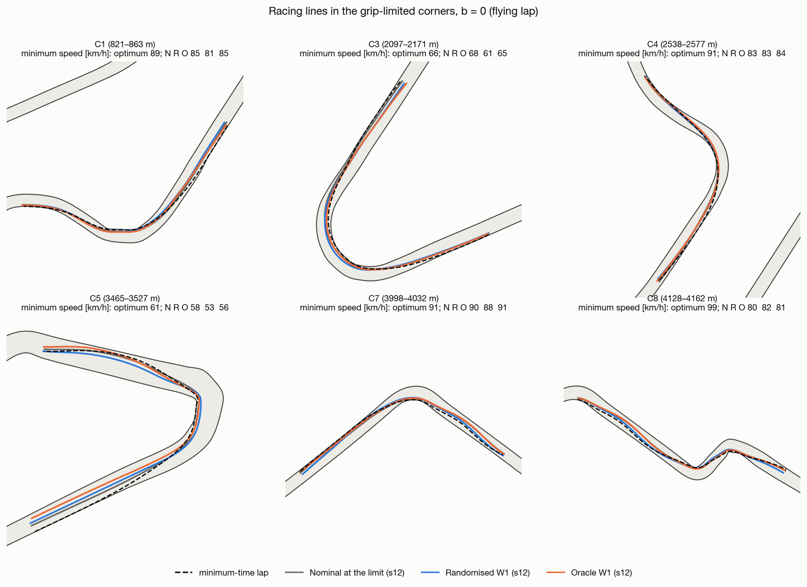</td>
<td width="50%">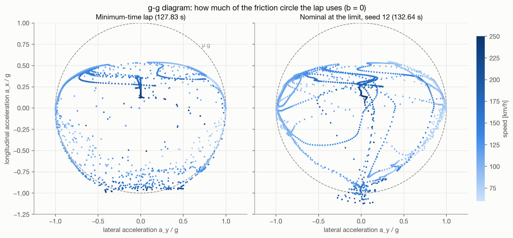</td>
</tr>
<tr>
<td><em>Racing lines in six grip-limited corners: the policies take nearly the optimal line, slightly narrower; minimum speeds in the titles.</em></td>
<td><em>g-g diagram: the minimum-time lap rides the edge of the friction circle; the policy reaches it too, but less consistently, with more of the lap inside it.</em></td>
</tr>
</table>

The tyres show how the policy drives. The minimum-time lap holds **both** axles at their peak slip through every grip-limited corner. The policy spreads its slip below and beyond the peak. In the windows of the nine corners of the protocol laps, it keeps the front axle beyond its peak in 19–43 % of the samples, and the rear near its peak (at least 0.9 of it) in only 6–23 %. It drives with understeer, a margin bought with a slower corner.

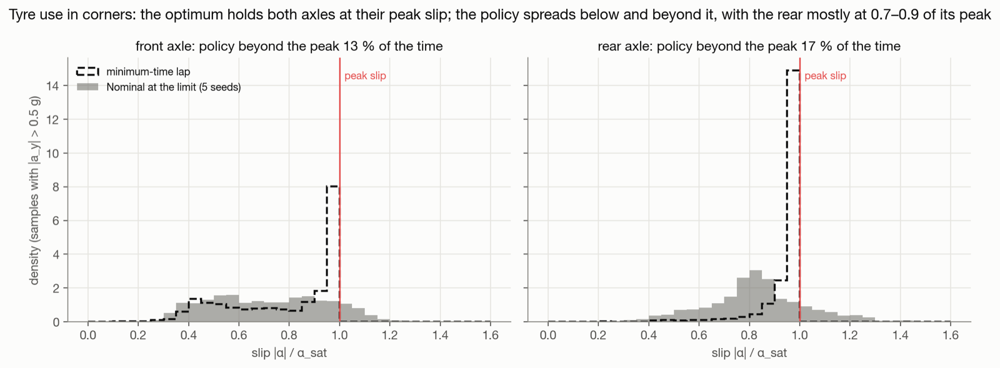

*Slip of each axle over its peak slip on the flying laps of the five seeds, in every sample with a lateral acceleration above 0.5 g. This set is wider than the corner windows above, so the shares beyond the peak in the titles are not the same numbers. The rear sits mostly at 0.7–0.9 of its peak.*

**Most of the gap is the line, not the grip.** The policy never comes closer than 0.55 m to an edge, so the 0.3 m margin of training is never active. Where the minimum-time lap touches an edge, the policy stays 1.1–1.6 m from it at the apex, and 2.5–4.1 m from it at corner entry and exit: it does not open the corner on the outside. Solving the minimum-time lap again with both edges moved inwards by d (`min_time_lap.py --edge-margin`) gives the cost of a narrower line:

| d (m)    | 0      | 0.3    | 0.6    | 1.0    | 1.5    | 2.0    | 2.5    | 3.0    | 3.5    |
| -------- | ------ | ------ | ------ | ------ | ------ | ------ | ------ | ------ | ------ |
| T(d) (s) | 127.83 | 128.29 | 128.76 | 129.41 | 130.25 | 131.11 | 132.00 | 132.92 | 133.93 |

- **The cost of the line.** Each metre taken away on each side costs about 1.7 s. A minimum-time lap confined to the width the policy actually uses accounts for a median **88 %** of the policy's gap, over the nine flying laps of the Nominal and the continued Nominal (`edge_usage.py`).
- **The corner speeds already fit that line.** On that narrower track (d = 2.5 m) the policy is as fast as the minimum-time lap in every corner, or up to 1.4 m/s faster: given its line, it already uses the grip there is.
- **Two plausible causes.** With discounting, progress along the centreline favours the inside of a corner. Running wide at entry lowers `ds/dt` at once through `1 − kappa e_y`, while the time it gains arrives later, at the exit. The policy also keeps from the edges the margin it needs to drive with the noise of training (section 7.4).
- **A reward on time did not help.** A reward that pays the progress made in a corner only when the car leaves it was tried on two seeds, as a 150 M continuation and from random weights for 600 M decisions. Both runs learned to drive (20 of 20 laps from random weights), but they were 0.4–1.5 points slower than their paired controls and did not widen their line consistently. The gap is reported as it is, and that reward is not kept in the code.

Continuing the training for 150 M decisions at a lower learning rate brings the seeds to about +3.0–3.6 %. All configurations at `b = 0`, lap by lap:

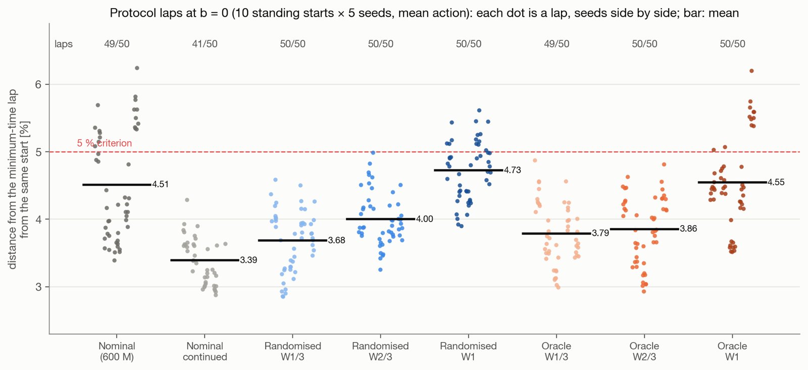

### 7.3 Handling balance at the limit: Nominal, Randomised and Oracle

Seven configurations of five seeds continue from the Nominal at the limit for 150 M decisions: the continued Nominal at `b = 0`, and Randomised (R) and Oracle (O) over three widths of the drivable range, W1/3 [−0.07, +0.01], W2/3 [−0.14, +0.02] and W1 [−0.21, +0.03], with the held-out values −0.04, −0.07 and −0.11. Every car of a 13-value grid is compared with **its own** minimum-time lap.

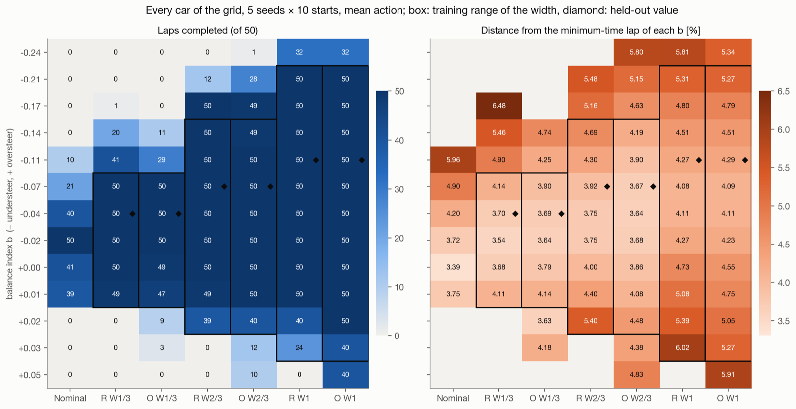

*Left: laps completed out of 50; right: mean distance from the minimum-time lap of that `b`. Boxes mark the training range of each width, diamonds the held-out value.*

- **At the limit `b` matters on every corner.** The Nominal drives only cars within about ±0.03 of its own (all 50 laps only at `b = −0.02`, none at `b = +0.02`).
- **Randomised and Oracle drive every car of their range, held-out values included (50/50), at 3.5–5 %** from each car's minimum-time lap. They reach 5–6 % only at the ends of the range. Held-out values are no worse than interpolated ones.
- **Randomisation costs lap time, not reliability.** At `b = 0` the Randomised policies are slower than the continued Nominal by +0.36 s [−0.28, 0.98], +0.81 s [0.40, 1.21] and +1.72 s [1.15, 2.42] (about 0.3, 0.6 and 1.3 %) for W1/3, W2/3 and W1: the wider the range, the more a single behaviour has to be a compromise.

**Knowing `b` changes the driving.** In the slowest corner, C5, the minimum-time lap of an understeering car carries much less speed through the apex. As the car gets more oversteering, the Oracle, like the minimum-time lap, enters slightly slower and carries more speed through the apex, on a different line; the Randomised policy drives nearly the same way for every car.

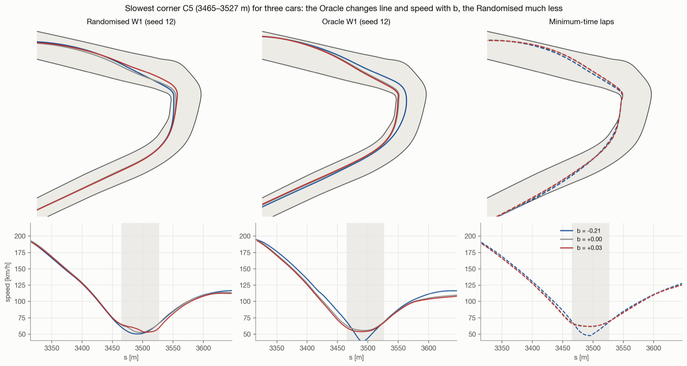

**But it gains little time inside the range.** Net of the gap the two policies already show at `b = 0`, the regret (Randomised − Oracle) over interpolated and held-out values is +0.18 s [0.07, 0.28] for W1/3, +0.24 s [−0.04, 0.45] for W2/3 and −0.07 s [−0.32, 0.18] for W1, and the net completion difference is at most +0.05 [0.01, 0.09]. The rule fixed before the evaluation (net regret ≥ 0.5 s or net completion ≥ 0.10, with the lower bound above zero) is met for no width, so **a policy with memory, which would infer `b` from its history, is not needed here**.

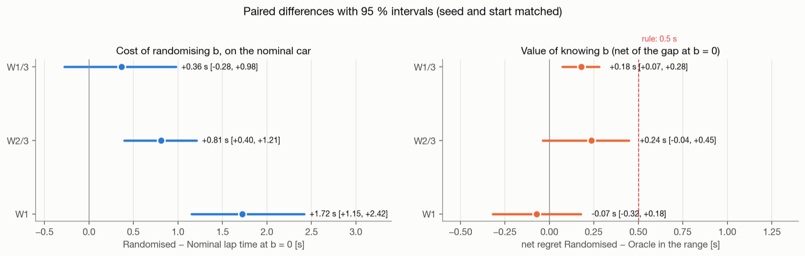

The Oracle's clear advantage is **outside** the range, on more oversteering cars: at `b = +0.05` the Oracle W1 completes 40 of 50 laps, the Randomised W1 none.

<p align="center">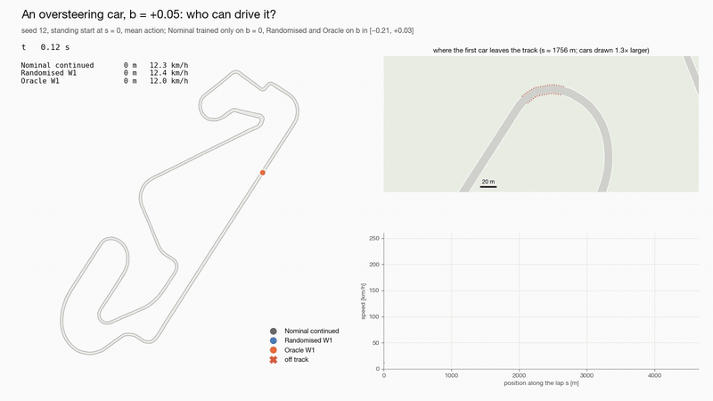</p>

*An oversteering car, `b = +0.05`, outside every training range: from the same standing start, the continued Nominal and the Randomised W1 leave the track at the exit of the same corner, the Oracle W1 completes the lap.*

### 7.4 Mean action and stochastic policy

With the mean action, one continued-Nominal seed (seed 14) completes only 1 of 10 laps at `b = 0`, but 9–10 of 10 with the stochastic policy; this alone makes the 41/50 of the continued Nominal. Driving the protocol with scaled noise shows that:

- **clipping is not the cause**: the mean action stays inside the action box, and the clipping bias is below 0.02 everywhere and practically zero before every exit;
- **the failure is a deterministic trajectory without margin**: from every start, the mean action reaches corner C3 on the same trajectory and, at its exit, keeps steering into the corner while the throttle rises; the rear axle goes further and further beyond its peak until the car leaves the track at 2167.8 m. The noisy runs countersteer there and stay on track. A tenth of the training noise is enough to complete 24 of 30 laps;
- **the mean action is the fastest way to drive**: the gap from the limit grows monotonically with the noise for every model, and the policy keeps from the edge about the margin it needs for the noise of training, not more (28–30 of 30 laps at k = 1, 12–28 of 30 at k = 2).

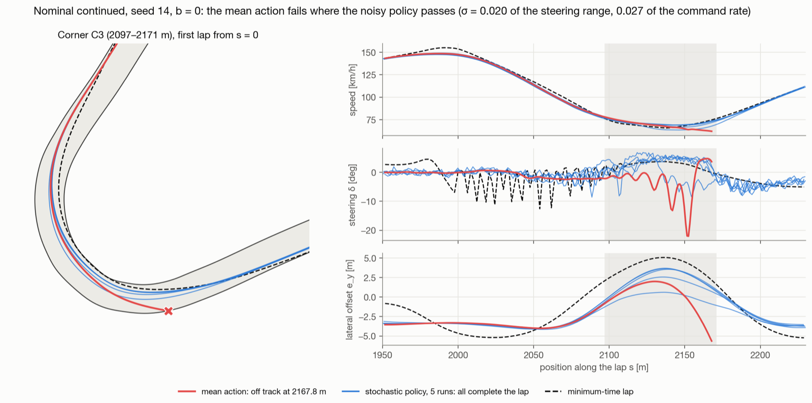

---

## Figures, animations and lap viewer — `scripts/figures/`

The figures and animations of the results at the limit are built from recorded laps, in two steps. `record_laps.py` drives the trained policies and records one sample per decision (state, commands, accelerations, tyre slips and loads, world pose) to `outputs/trajectories/`: a flying lap of every configuration at `b = 0`, three policies over five values of `b`, the mean action and five stochastic runs of the case of the mean action that leaves the track, and the flying minimum-time lap of every `b` resampled in time. `thesis_plots.py` holds what the others share (style, colours, track geometry, loading of the recorded laps).

- `make_thesis_figures.py`: 19 static figures as PNG and PDF (track and minimum-time line, speed and lap-time profiles against the minimum-time lap, corner lines, g-g diagram, tyre usage, training curves, distance from the limit, results over `b`, failure map, mean action against the stochastic policy, cost and regret); `--no-titles` leaves out the titles, for a caption;
- `animate_laps.py`: GIF and MP4 animations — a chase view of each policy with the ghost of the minimum-time lap, the three policies racing on the whole circuit, cars with different `b`, and the mean action against stochastic runs — rendered with matplotlib and assembled with ffmpeg;
- `build_lap_viewer.py`: fills the template `lap_viewer.html` with the track and the recorded laps and writes one self-contained HTML page for browsing them, with play, scrub, playback speed, a view that follows the car and live gaps.

```bash
python scripts/figures/record_laps.py
python scripts/figures/make_thesis_figures.py
python scripts/figures/animate_laps.py --only chase
python scripts/figures/build_lap_viewer.py
```

The figures of this README are a selection of these, in `docs/figures/`; the two GIFs are shortened, smaller versions of the chase and balance animations.

---

## Tests

```bash
pytest                                  # plant, balance index, environment, tracks, learning and evaluation (seconds)
python scripts/check_balance_index.py   # steady-state check of b -> outputs/analysis/balance_index.json
python scripts/measure_throughput.py    # decisions/s of the environment -> outputs/analysis/throughput.json
```

`tests/golden/plant_catalunya.npz` holds reference rollouts of the original dynamics alone on the Catalunya centreline (`tests/test_plant.py`), which `ORIGINAL_PLANT` must reproduce bit for bit; `tests/golden/plant_catalunya_gt4.npz` holds those of the current plant, which any later change must reproduce. The same file checks the drag and power (top speed, acceleration, coast-down, within 1 %) and that a slide no longer unloads an axle; `tests/test_balance.py` pins what `b` changes; `tests/test_min_time.py` checks the equations of the minimum-time problem against the plant and the edges moved inwards by `--edge-margin` (it runs when CasADi is installed).

The earlier line of this project, which trained policies by imitation of a model-based teacher on four circuits, is kept at the tag `legacy-imitation`.
