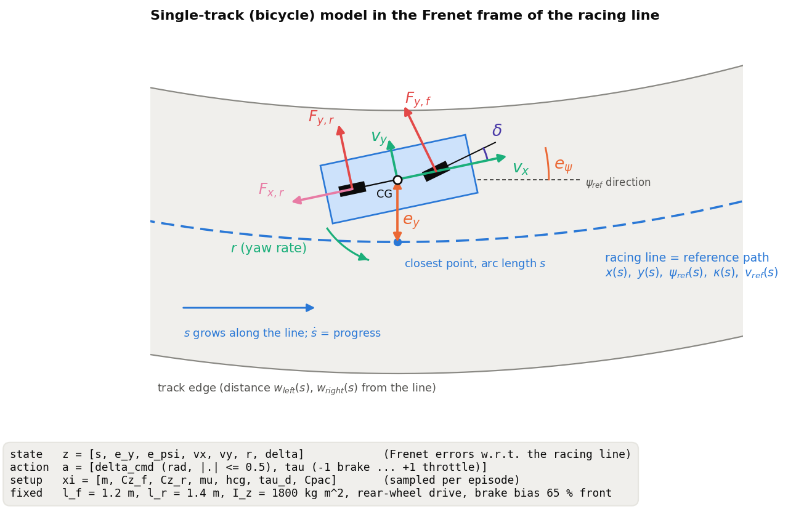
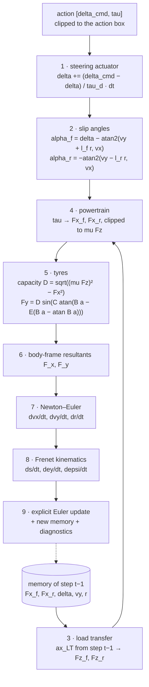
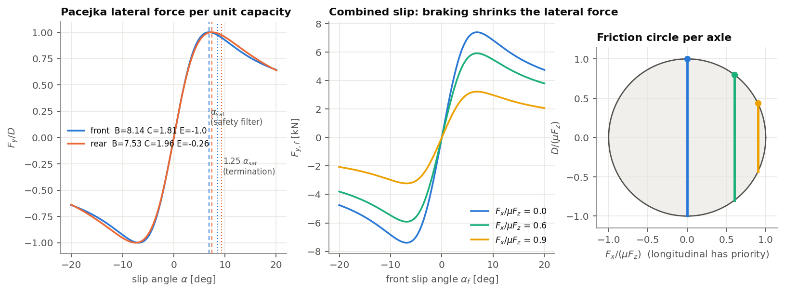

# Contextual Bicycle Pacejka

A simulated race car on real circuits (Monza, Spa, Catalunya and Budapest): a single-track Pacejka plant with combined slip and longitudinal load transfer, the circuits' centreline geometry, and a Gymnasium environment.

The project studies **pure model-free reinforcement learning**: policies that learn to race only from interaction with the simulator, with no shield, no behaviour cloning and no demonstrations from model-based controllers, and that are tested across vehicle handling balances. The vehicle family varies in one scalar, the balance index `b`, which moves lateral grip between the axles; the policies learn through stages of increasing top speed.

The previous imitation line (scripted teacher, safety filter, perturbed demonstrations, behaviour cloning, offline RL, friction estimator, plan coach) is kept at the git tag `legacy-imitation`.

## Contents

- [Quick start](#quick-start)
- [Repository layout](#repository-layout)
- [1. Vehicle plant](#1-vehicle-plant--model)
- [2. Tracks](#2-tracks--modeltrackpy-tracks)
- [3. Environment](#3-environment--env)
- [4. The learning problem: state, observation, action, reward](#4-the-learning-problem-state-observation-action-reward)
- [5. Training](#5-training--learning)
- [Tests](#tests)

## Quick start

```bash
python -m venv .venv && source .venv/bin/activate
pip install -e ".[dev]"
pytest                   # plant, balance index, environment, tracks and analysis (seconds)
```

## Repository layout

```
src/contextual_bicycle_pacejka/
    spec/        constants and the layouts of the state, setup, observation and action vectors
    model/       vehicle plant, tyres, load transfer, powertrain, track, steady-state handling, observation, failures, reward
    env/         Gymnasium environment at 20 Hz, its factory and vectorised form, speed stages, setup sampling
    tracks/      centreline reference of a circuit from the TUM racetrack database
    learning/    PPO configuration and training curves
    evaluation/  result analysis (Wilson, McNemar, several seeds) and the check of the balance index
data/tracks/     the four circuits: TUM centreline CSV and its reference (curvature and track widths)
docs/figures/    figures of this README
research/        literature corpus metadata (the papers and third-party code are not tracked)
scripts/         command-line entry points (training, check of the balance index, throughput of the environment)
tests/           plant and environment rollouts, balance index, track preparation, analysis, against recorded golden data
```

## 1. Vehicle plant — `model/`

The car is a **single-track (bicycle) model** written in the **Frenet frame** of the circuit's centreline: the car is described by how far along the centreline it is (`s`), how far to its side (`e_y`) and how its heading differs from the centreline's (`e_psi`). The plant is pure NumPy/SciPy with no Gymnasium dependency, and every quantity is float64.



| File                     | Content                                                                                                                                       |
| ------------------------ | --------------------------------------------------------------------------------------------------------------------------------------------- |
| `model/state.py`         | `VehicleState` (7 states), `VehicleMemory` (previous-step forces for load transfer), `SetupVector` (5 setup parameters), `AdmissibilityError` |
| `model/actuator.py`      | first-order steering lag                                                                                                                      |
| `model/tires.py`         | slip angles, lateral capacity scales of the balance index, combined-slip capacity, Pacejka lateral force, peak slip angle `alpha_sat`       |
| `model/load_transfer.py` | longitudinal load transfer from the previous step                                                                                             |
| `model/powertrain.py`    | rear-wheel drive, brake bias, friction limit on the longitudinal forces, top-speed bound of a stage                                           |
| `model/dynamics.py`      | `step_plant`: one 10 ms step in causal order                                                                                                  |
| `model/handling.py`      | steady state: constant-radius trim, understeer gradient, lateral limit, yaw stability and critical speed                                      |
| `model/track.py`         | `RealTrack`: periodic-spline centreline with the track widths (see section 2)                                                                 |
| `model/observation.py`   | the observation of the racing policies (see section 4)                                                                                        |
| `model/termination.py`   | failures: off track, spin, stall                                                                                                              |
| `model/reward.py`        | reward of one decision: normalised progress, action rate, failure                                                                             |
| `spec/constants.py`      | every number of the model, with its unit                                                                                                      |

**Fixed vehicle data** (`spec/constants.py`): `l_f = 1.2 m`, `l_r = 1.4 m`, `I_z = 1800 kg m²`, `A_MAX = 8 m/s²`, `D_MAX = 12 m/s²`, front brake share `BETA_BRAKE = 0.65`, steering limit `DELTA_MAX = 0.5 rad`, integration step `DT = 0.01 s` (100 Hz, explicit Euler).

### One plant step

`step_plant(state, action, setup, memory, track, dt)` advances the car by one step. The order is causal: the load transfer uses the forces of the **previous** step, so there is no algebraic loop.



The equations, as implemented:

```
actuator      delta'   = clip(delta + (delta_cmd - delta) / tau_d * dt, ±0.5)
load transfer ax_LT    = (Fx_r,prev + Fx_f,prev cos delta_prev) / m + vy_prev r_prev
              Fz_f     = m / L (g l_r - ax_LT hcg),     Fz_r = m / L (g l_f + ax_LT hcg),     L = l_f + l_r
powertrain    tau >= 0: Fx_f = 0,                       Fx_r = tau m A_MAX
              tau <  0: Fx_f = tau m D_MAX 0.65,        Fx_r = tau m D_MAX 0.35
              |Fx_i| <= mu Fz_i
dynamics      dvx/dt = F_x / m + vy r,    dvy/dt = F_y / m - vx r,    dr/dt = (l_f (F_y - Fy_r) - l_r Fy_r) / I_z
Frenet        ds/dt  = (vx cos e_psi - vy sin e_psi) / (1 - kappa(s) e_y)
              de_y/dt = vx sin e_psi + vy cos e_psi,      de_psi/dt = r - kappa(s) ds/dt
```

The plant raises `AdmissibilityError` if an axle load becomes non-positive or if `1 − kappa e_y ≤ 0` (the Frenet frame becomes singular). The environment turns this into a clean termination.

### Tyres

Each axle has a Pacejka "magic formula" lateral force. `C` and `E` are the identified AV-24 shape and curvature factors (Jardali et al.); `B` is calibrated so that the force peaks at about 0.12 rad (front) and 0.13 rad (rear). The peak `D` is the **combined-slip capacity**: the longitudinal force has priority, and the lateral force gets what is left of the friction circle `mu Fz`.

The **balance index** `b` moves lateral capacity between the axles at a constant static total: the lateral capacity of each axle is multiplied by `lambda_f = 1 + b` and `lambda_r = 1 − b LR / LF` (`compute_lateral_scales`), so that `lambda_f Fz_f0 + lambda_r Fz_r0 = Fz_f0 + Fz_r0`. A positive `b` moves grip to the front (oversteer), a negative one to the rear (understeer); `b = 0` is the original plant, bit for bit. The longitudinal limit stays `mu Fz` and `B, C, E` stay fixed, so the cornering stiffness scales with `lambda_i` and `alpha_sat` does not depend on `b`.



The peak slip angle `alpha_sat` (`compute_saturation_threshold`) depends only on `B, C, E`.

### Failures — `model/termination.py`

After every plant step the environment ends the episode on the first of:

| Failure        | Condition                                                                         |
| -------------- | --------------------------------------------------------------------------------- |
| `off_track`    | `e_y` beyond the edge distance on its side at `s` (left edge for `e_y > 0`)       |
| `spin`         | `\|e_psi\| > pi / 2`                                                              |
| `stall`        | `vx < 1.5 m/s`                                                                    |
| `inadmissible` | the plant raised `AdmissibilityError` (set by the environment)                    |

A completed lap does **not** end the episode.

---

## 2. Tracks — `model/track.py`, `tracks/`

`RealTrack(npz_path)` loads the centreline reference of a circuit and builds periodic cubic splines of every quantity, so every query wraps around the lap:

| NPZ key                       | Meaning                                   | Accessor                                                         |
| ----------------------------- | ----------------------------------------- | ---------------------------------------------------------------- |
| `s_m`, `track_length`         | arc length, lap length                    | `track_length`                                                   |
| `x_m`, `y_m`                  | world coordinates of the centreline       | `centerline_point(s)`                                            |
| `psi_rad`                     | heading (splined after removing the ±2π-per-lap trend) | `psi_ref(s)`                                        |
| `kappa_radpm`                 | signed curvature                          | `kappa(s)`                                                       |
| `w_tr_right_m`, `w_tr_left_m` | distances from the centreline to the track edges | `boundary_right/left(s)`, `ey_max(s)`, `is_out_of_bounds(ey, s)` |

The edge distances are the circuit's own: the car leaves the track when its lateral offset exceeds them.

`tracks/reference.py` builds the reference from the TUM racetrack database CSV (`x, y, w_right, w_left`): it closes the centreline, centres it at the origin, and computes the arc length, the heading and a smoothed curvature (`data/tracks/<circuit>/tum_centerline.csv` → `reference.npz`).

| Circuit   | Centreline length (km) | Track width (m) |
| --------- | ---------------------- | --------------- |
| Monza     | 5.79                   | 7.5 – 12.4      |
| Spa       | 7.00                   | 7.9 – 16.4      |
| Catalunya | 4.65                   | 8.6 – 17.8      |
| Budapest  | 4.38                   | 7.6 – 16.1      |

---

## 3. Environment — `env/`

`RacingEnv` (`env/environment.py`) is a Gymnasium environment on one circuit and one **speed stage**; decisions are taken at **20 Hz** (every 5 plant steps). `make_env(reference, stage, b_range, oracle)` (`env/factory.py`) builds it and adds a `TimeLimit` of 1024 decisions (51.2 s); `make_vec_env(reference, n_envs, seed, ..., workers)` builds `n_envs` copies for PPO: with `workers > 0` they run in that many subprocesses, several per process (`BatchedSubprocVecEnv`, `env/vec_env.py`), with one message per process and decision; with `workers = 0` in this process. On a 10-core machine, 10 processes × 32 environments give about 43,000 decisions/s.

```python
from contextual_bicycle_pacejka.env import make_env
import numpy as np

env = make_env("data/tracks/catalunya/reference.npz", stage=4, b_range=(-0.2, 0.17), oracle=True)
obs, info = env.reset(seed=42, options={
    "initial_s": 400.8,      # optional: uniform on the lap
    "initial_vx": 20.0,      # optional: uniform between 3 m/s and the top speed of the previous stage
})
obs, reward, terminated, truncated, info = env.step(np.array([0.0, 0.5], dtype=np.float32))
```

**Reset.** Draws (or receives) the setup with its balance index, places the car on the centreline (`e_y = e_psi = vy = r = delta = 0`) at a random point of the lap and a random speed, zeroes the memory and the commands, and returns the first observation.

**Step.** The action `[a_1, a_2] ∈ [−1, 1]²` gives the steering reference `delta_ref = 0.5 a_1` rad and the rate `5 a_2` 1/s of the longitudinal command `tau`, integrated once per decision. The same top-speed bound caps the integrated command, so that it does not wind up to full throttle while the speed is bounded. Then, for 5 plant steps: the traction fades out within 5 % of the top speed of the stage (`limit_top_speed`), `step_plant` advances the car, and the failures are checked; the decision stops at the first failure. A failure ends the episode with its penalty; the vectorised environment starts the next one at once, at a random point of the centreline, as in Czechmanowski et al. (IROS 2025). `info` holds the `failure` (or None), the `reward_terms`, the `progress` [m], the raw `state` and `setup`, and the `laps` completed.

### Speed stages — `env/stages.py`

The policy learns at increasing top speeds: 5, 10, 20, 30, 40, 60 m/s, then with no bound (the free stage is sized at 92 m/s: the plant has no drag, and a point-mass profile of Catalunya with its limits peaks at 91 m/s). `make_stage(number, track)` sets every speed-dependent parameter from an explicit rule:

| Parameter        | Rule                                                                                     |
| ---------------- | ---------------------------------------------------------------------------------------- |
| preview horizon  | braking distance `v² / (2 mu g)` plus one second, `v` the top speed                       |
| preview points   | 30, equally spaced, the first one decision ahead (`0.05 v`)                              |
| scales           | speed `v`; yaw rate `min(v, sqrt(mu g R_min)) / R_min`; widths `w_max`; curvature `1 / R_min` |
| start speeds     | uniform between 3 m/s and the top speed of the previous stage                            |

`R_min` (22.8 m on Catalunya) is the radius of the tightest corner and `w_max` (9.3 m) the widest half-width.

### Setup sampling — `env/setup_sampling.py`

Every episode has its own setup `xi = [m, mu, hcg, tau_d, b]`. Only the balance index varies; the other entries stay at their nominal values:

| Entry   | Meaning                  | Value                                   |
| ------- | ------------------------ | --------------------------------------- |
| `m`     | mass                     | 1400 kg                                 |
| `mu`    | peak tyre-road friction  | 1.0                                     |
| `hcg`   | centre-of-gravity height | 0.50 m                                  |
| `tau_d` | steering lag             | 0.03 s                                  |
| `b`     | balance index            | uniform in `b_range` (default: `b = 0`) |

`sample_setup(rng, b_range)` draws a setup; `randomized_setup(mu, default_rng(seed), b_range)` also **overwrites** its friction by `mu`, so that every episode is reproducible from `(mu, seed)`.

---

## 4. The learning problem: state, observation, action, reward

Seen as a reinforcement-learning problem, the task is a **contextual MDP**: the context is the balance index `b` of the setup `xi`, sampled at reset and constant within the episode.

| Element     | Definition                                                        | Where                                        |
| ----------- | ----------------------------------------------------------------- | -------------------------------------------- |
| Plant state | `z = [s, e_y, e_psi, vx, vy, r, delta]` + one-step memory         | `model/state.py`                             |
| Context     | `xi = [m, mu, hcg, tau_d, b]`, `b` uniform per episode            | `env/setup_sampling.py`                      |
| Observation | 100 float32 entries (101 for the Oracle, with `b`), scaled per stage | `model/observation.py`, `spec/layout.py`   |
| Action      | `[delta_ref, tau rate] ∈ [−1, 1]²`, at 20 Hz                       | `spec/layout.py`                             |
| Transition  | 5 deterministic `step_plant` steps of 10 ms explicit Euler        | `model/dynamics.py`, `env/environment.py`    |
| Reward      | normalised progress − action rate − failure penalty               | `model/reward.py`                            |
| Termination | off track, spin, stall, inadmissibility                           | `model/termination.py`                       |
| Truncation  | `TimeLimit` (1024 decisions, 51.2 s)                              | `env/factory.py`                             |

The dynamics are deterministic: all the randomness is in the setup and the start.

### State

The **plant state** `z` (float64) lives in the Frenet frame of the centreline:

| Index | Symbol  | Unit  | Meaning                                                              |
| ----- | ------- | ----- | -------------------------------------------------------------------- |
| 0     | `s`     | m     | arc length along the centreline (not wrapped: it grows across laps)  |
| 1     | `e_y`   | m     | lateral distance from the line, positive to the left                 |
| 2     | `e_psi` | rad   | heading of the car minus heading of the line                         |
| 3     | `vx`    | m/s   | longitudinal velocity in the body frame                              |
| 4     | `vy`    | m/s   | lateral velocity in the body frame                                   |
| 5     | `r`     | rad/s | yaw rate                                                             |
| 6     | `delta` | rad   | actual (post-actuator) steering angle                                |

The plant also keeps a **memory** of the previous step (`Fx_r, Fx_f, delta, vy, r`) for the load transfer. The controllers never see `s` directly or the memory: they see the observation.

### Observation (100 entries, 101 for the Oracle)

The observation is assembled by `build_observation` after every decision. Its layout is fixed in `spec/layout.py` (`OBS.*` indices); every entry is divided by a scale of the speed stage:

| Index   | Content                                                                    | Scale                          |
| ------- | -------------------------------------------------------------------------- | ------------------------------ |
| 0–1     | `vx, vy`                                                                   | top speed                      |
| 2       | yaw rate `r`                                                               | yaw-rate scale of the stage    |
| 3–4     | `e_psi, e_y` (to the centreline)                                           | pi / 2, `w_max`                |
| 5–6     | steering angle `delta`, previous reference `delta_ref`                     | 0.5 rad                        |
| 7–8     | longitudinal command `tau`, its previous rate                              | 1, 5 1/s                       |
| 9       | friction `mu`                                                              | 1                              |
| 10–39   | mean curvature over the 30 preview intervals (integral of the curvature)   | `1 / R_min`                    |
| 40–69   | left half-width at the 30 preview points                                   | `w_max`                        |
| 70–99   | right half-width at the 30 preview points                                  | `w_max`                        |
| 100     | balance index `b` (**Oracle only**)                                        | 0.2                            |

Nominal and Randomised policies read no hidden parameter of the car; the Oracle reads `b`.

### Action

| Index | Symbol      | Range   | Meaning                                                                                               |
| ----- | ----------- | ------- | ----------------------------------------------------------------------------------------------------- |
| 0     | `delta_ref` | [−1, 1] | steering reference `0.5 a_1` rad; the actual angle follows with lag `tau_d`                           |
| 1     | `tau rate`  | [−1, 1] | rate `5 a_2` 1/s of `tau`; `tau ≥ 0`: throttle, rear force `tau m A_MAX`; `tau < 0`: brake, `tau m D_MAX` split 65/35 |

### Reward — `model/reward.py`

```
r_k = ds_k / (v · 0.05 s)                                        progress along the centreline, at most about 1
    − 0.01 · [(Δdelta_ref / 1 rad)² + (tau rate / 5 1/s)²]       change of the actions
    − 1 · 1[failure]
```

`v` is the top speed of the stage, so the failure penalty keeps the same weight at every stage. The learner receives `0.1 r_k`: discounted returns of about 10, close to those of progress in metres in Czechmanowski et al., which keeps the value loss small without changing the optimum. The progress reward follows Czechmanowski et al. (IROS 2025, equation 3).

---

## 5. Training — `learning/`

PPO of Stable-Baselines3 is configured as in Czechmanowski et al. (IROS 2025) (`learning/ppo.py`):

| Setting                 | Value                                                          |
| ----------------------- | -------------------------------------------------------------- |
| actor, critic           | separate MLPs, 256 × 2 and 512 × 2, LeakyReLU (slope 0.2)      |
| environments, rollout   | 320 (10 processes × 32), 1024 decisions each                   |
| discount                | 0.99 per decision (about 5 s)                                  |
| learning rate           | linear from 1e-3 to 1e-4 over each stage                       |
| minibatch, epochs       | 1024, 5                                                        |
| other settings          | Stable-Baselines3 defaults                                     |

The policy trains through the speed stages in order, each stage starting from the weights of the previous one (the optimiser starts afresh), for 20 M decisions per stage at 5 and 10 m/s and 60 M decisions per stage from 20 m/s. Training runs at about 22,000 decisions/s on a 10-core machine, update included.

```bash
python scripts/train_curriculum.py --seed 0 --stages 1 --budget 20000000
python scripts/train_curriculum.py --seed 0 --stages 2 --budget 20000000 --init outputs/models/nominal/s0/stage1.zip
```

---

## Tests

```bash
pytest                   # plant, balance index, environment, tracks and analysis (seconds)
python scripts/check_balance_index.py   # steady-state check of b -> outputs/analysis/balance_index.json
python scripts/measure_throughput.py    # decisions/s of the environment -> outputs/analysis/throughput.json
```

`tests/golden/plant_catalunya.npz` holds reference rollouts of the dynamics alone on the Catalunya centreline (`tests/test_plant.py`): any change to the plant, such as the balance index at its neutral value, must reproduce them bit for bit; `tests/test_balance.py` pins what `b` changes. The analysis tests use results recorded from the original implementation.
